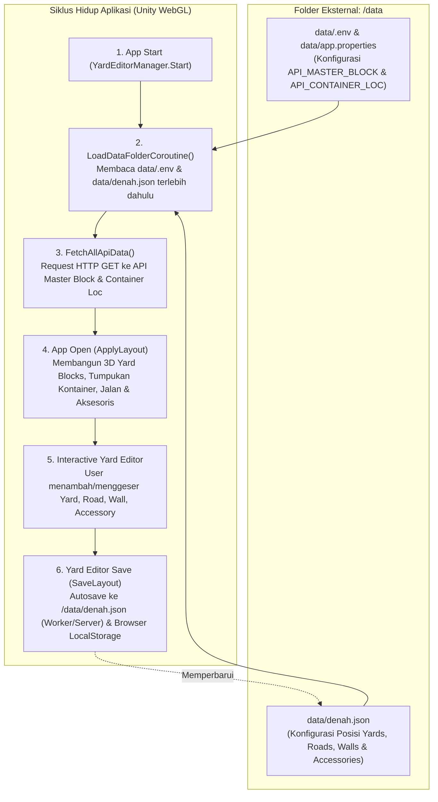

# 1Eagle Virtual Reality & Interactive Yard Editor — Dokumentasi Lengkap Proyek & Kode

> **Versi Engine:** Unity `6000.2.14f1` (Unity 6.2 LTS — Universal Render Pipeline / URP 17.2.0)  
> **Target Platform:** WebGL (Desktop Browser, Mobile Browser, WebXR / Split-Screen VR Headset) & PC Standalone  
> **Active Scene Utama:** `Assets/Scenes/Copy.unity`  
> **Repository / Project Root:** `Reality Eagle`

---

## Daftar Isi

1. [Gambaran Umum Proyek (Project Overview)](#1-gambaran-umum-proyek-project-overview)
2. [Arsitektur Sistem & Alur Data (System Architecture & Data Flow)](#2-arsitektur-sistem--alur-data-system-architecture--data-flow)
3. [Struktur Direktori Proyek & Build Output](#3-struktur-direktori-proyek--build-output)
4. [Panduan Penggunaan Lengkap (How to Use)](#4-panduan-penggunaan-lengkap-how-to-use)
   - [4.1. Navigasi Kamera (3D View, 2D View, Walk / VR Mode)](#41-navigasi-kamera-3d-view-2d-view-walk--vr-mode)
   - [4.2. Pencarian & Inspeksi Kontainer (Container Search & Info Card)](#42-pencarian--inspeksi-kontainer-container-search--info-card)
   - [4.3. Penggunaan Yard Editor (2D Layouting Mode)](#43-penggunaan-yard-editor-2d-layouting-mode)
   - [4.4. Mobile VR Remote Sync (Connect Phone / WebRTC)](#44-mobile-vr-remote-sync-connect-phone--webrtc)
5. [Panduan Build, Konfigurasi & Deployment (How to Build & Deploy)](#5-panduan-build-konfigurasi--deployment-how-to-build--deploy)
   - [5.1. Persyaratan Sistem & Paket Unity](#51-persyaratan-sistem--paket-unity)
   - [5.2. Optimasi Waktu Build WebGL (Anti-Stuck Shader & Mesh Optimization)](#52-optimasi-waktu-build-webgl-anti-stuck-shader--mesh-optimization)
   - [5.3. Langkah-Langkah Build WebGL di Unity Editor](#53-langkah-langkah-build-webgl-di-unity-editor)
   - [5.4. Konfigurasi Endpoint API & Layout Tanpa Build Ulang (`data/`)](#54-konfigurasi-endpoint-api--layout-tanpa-build-ulang-data)
   - [5.5. Panduan Deploy ke Cloudflare Pages, Netlify, Vercel, atau Server PHP](#55-panduan-deploy-ke-cloudflare-pages-netlify-vercel-atau-server-php)
6. [Bedah Kode Lengkap: File demi File & Baris demi Baris (Code & Line Reference)](#6-bedah-kode-lengkap-file-demi-file--baris-demi-baris-code--line-reference)
   - [6.1. Modul Yard Editor (`Assets/Scripts/YardEditor/`)](#61-modul-yard-editor-assetsscriptsyardeditor)
     - [`YardEditorManager.cs` (3.606 Baris)](#611-yardeditormanagercs-3606-baris)
     - [`YardEditorUI.cs` (2.104 Baris)](#612-yardeditoruics-2104-baris)
     - [`YardEditorData.cs` (1.083 Baris)](#613-yardeditordatacs-1083-baris)
     - [`DraggableRoad.cs` (489 Baris)](#614-draggableroadcs-489-baris)
     - [`DraggableYard.cs` (239 Baris)](#615-draggableyardcs-239-baris)
   - [6.2. Modul Manajemen Kontainer & Pencarian (`Assets/Scripts/`)](#62-modul-manajemen-kontainer--pencarian-assetsscripts)
     - [`ContainerManager.cs` (2.088 Baris)](#621-containermanagercs-2088-baris)
     - [`ContainerSearchManager.cs` (902 Baris)](#622-containersearchmanagercs-902-baris)
     - [`ContainerDetailCuller.cs` (73 Baris)](#623-containerdetailcullercs-73-baris)
   - [6.3. Modul Kamera, VR & Sinkronisasi WebRTC (`Assets/Scripts/`)](#63-modul-kamera-vr--sinkronisasi-webrtc-assetsscripts)
     - [`VRRemoteSyncManager.cs` (965 Baris)](#631-vrremotesyncmanagercs-965-baris)
     - [`ViewModeManager.cs` (598 Baris)](#632-viewmodemanagercs-598-baris)
     - [`VRPlayerController.cs` (498 Baris)](#633-vrplayercontrollercs-498-baris)
     - [`OrbitCamera.cs` (200 Baris)](#634-orbitcameracs-200-baris)
     - [`XRHeadMovement.cs` (79 Baris)](#635-xrheadmovementcs-79-baris)
     - [`VRModeManager.cs` (63 Baris)](#636-vrmodemanagercs-63-baris)
     - [`GyroCamera.cs` (59 Baris)](#637-gyrocameracs-59-baris)
   - [6.4. Modul Lingkungan, Marka Jalan & Pencahayaan (`Assets/Scripts/`)](#64-modul-lingkungan-marka-jalan--pencahayaan-assetsscripts)
     - [`YardBoundary.cs` (399 Baris)](#641-yardboundarycs-399-baris)
     - [`DayNightController.cs` (375 Baris)](#642-daynightcontrollercs-375-baris)
     - [`AutoPagarBesi.cs` (329 Baris)](#643-autopagarbesics-329-baris)
     - [`DashedLineGenerator.cs` (222 Baris)](#644-dashedlinegeneratorcs-222-baris)
     - [`RoadMarkingGenerator.cs` (10 Baris)](#645-roadmarkinggeneratorcs-10-baris)
   - [6.5. Modul Unity Editor & Build Automation (`Assets/Scripts/Editor/`)](#65-modul-unity-editor--build-automation-assetsscriptseditor)
     - [`CleanPre1EagleScene.cs` (113 Baris)](#651-cleanpre1eaglescenecs-113-baris)
     - [`WebGLPostBuildDataFolder.cs` (110 Baris)](#652-webglpostbuilddatafoldercs-110-baris)
     - [`ContainerDoorDebugger.cs` (83 Baris)](#653-containerdoordebuggercs-83-baris)
     - [`WebGLTextureOptimizer.cs` (81 Baris)](#654-webgltextureoptimizercs-81-baris)
     - [`WebGLPostProcessBuild.cs` (69 Baris)](#655-webglpostprocessbuildcs-69-baris)
     - [`SceneCleaner.cs` (47 Baris)](#656-scenecleanercs-47-baris)
   - [6.6. Plugin JavaScript Bridge WebGL (`Assets/Plugins/WebGL/`)](#66-plugin-javascript-bridge-webgl-assetspluginswebgl)
     - [`YardLocalStorage.jslib` (60 Baris)](#661-yardlocalstoragejslib-60-baris)
     - [`VRRemoteBridge.jslib` (35 Baris)](#662-vrremotebridgejslib-35-baris)
     - [`MobileDetector.jslib` (17 Baris)](#663-mobiledetectorjslib-17-baris)
   - [6.7. Template WebGL, Fetch Interceptor & Cloudflare Worker (`Assets/WebGLTemplates/WebXRFullView2020/`)](#67-template-webgl-fetch-interceptor--cloudflare-worker-assetswebgltemplateswebxrfullview2020)
     - [`index.html` (688 Baris)](#671-indexhtml-688-baris)
     - [`_worker.js` (146 Baris)](#672-_workerjs-146-baris)
     - [`data/.env`, `data/app.properties`, `data/denah.json`, `data/save_denah.php`](#673-folder-konfigurasi-data)
7. [Rumus Matematika & Algoritma Penting dalam Proyek](#7-rumus-matematika--algoritma-penting-dalam-proyek)
8. [Troubleshooting & Solusi Masalah Umum (FAQ)](#8-troubleshooting--solusi-masalah-umum-faq)
9. [Panduan Git & Push ke GitHub](#9-panduan-git--push-ke-github)

---

## 1. Gambaran Umum Proyek (Project Overview)

**1Eagle Virtual Reality & Interactive Yard Editor** adalah aplikasi visualisasi Digital Twin 3D dan Virtual Reality berbasis **Unity 6 (WebGL)** untuk manajemen lapangan penumpukan peti kemas (*Container Yard Terminal*). Aplikasi ini memungkinkan pengguna untuk:

1. **Memantau Posisi Kontainer secara Real-Time dari API Backend:**
   - Mengambil daftar *Master Block* (`getMasterBlock`) beserta dimensi kapasitas *Slot*, *Row*, dan *Tier*.
   - Mengambil daftar posisi kontainer aktif (`getCtrLoc`) lengkap dengan nomor kontainer, ukuran (`20ft` / `40ft`), kode ISO (`22G1`, `45G1`), operator/pelayaran (*Agent* / *Merk* seperti `MAERSK`, `MSC`, `CMA`, `EVERGREEN`, `ONE`, `COSCO`, `HAPAG`, `ZIM`, `YANG MING`, `WAN HAI`, `PIL`, `OOCL`, `SIT`), berat kotor (*Gross Weight*), dan kondisi (*Status*).
   - Merender stiker nomor kontainer berstandar **ISO 6346** (lengkap dengan kalkulasi otomatis *Check Digit* dalam kotak putih) pada pintu belakang dan kedua dinding samping kontainer.

2. **Mengedit Tata Letak Lapangan (Interactive 2D Yard Editor):**
   - Menambahkan, menggeser (*drag-and-drop*), dan memutar orientasi (`0°` / `90°`) blok lapangan (*Yard Blocks*) dari katalog API.
   - Membuat jaringan jalan aspal (*Roads*) dengan garis putus-putus putih dan panah arah lalu lintas yang ukurannya (*Width* & *Length*) dapat diubah secara dinamis.
   - Menambahkan pagar/dinding pembatas (*Walls / Pagar*) yang memanjang secara otomatis mengikuti panjang meteran tanpa terpecah saat dirotasi.
   - Menempatkan aksesoris terminal seperti Gedung Kantor (*Building*), Gerbang (*Gate*), *Reach Stacker*, dan *Top Loader*.
   - Menyimpan tata letak secara otomatis (*Autosave*) ke `data/denah.json` dan `LocalStorage` tanpa memunculkan popup dialog *Save As* yang mengganggu.

3. **Menjelajahi Terminal dalam 3 Mode Pandang & Sinkronisasi VR Lintas Perangkat:**
   - **3D View (Bird-Eye Orbit Camera):** Kamera bebas untuk memutar, menggeser (*panning*), dan memperbesar (*zoom*) seluruh area terminal.
   - **2D View (Top-Down Orthographic):** Tampilan cetak biru (*blueprint*) tegak lurus dari atas untuk melihat tata letak secara presisi.
   - **Walk / VR View (First-Person & Stereo VR):** Berjalan di atas tanah lapangan dengan kontrol *WASD* dan menghubungkan laptop (*Host*) dengan smartphone di dalam *VR Headset* (*Viewer*) secara real-time melalui **WebRTC PeerJS**.

---

## 2. Arsitektur Sistem & Alur Data (System Architecture & Data Flow)

Aplikasi ini dirancang mengikuti arsitektur berbasis konfigurasi eksternal (`data/`), sehingga **endpoint API maupun tata letak awal (`denah.json`) dapat diubah kapan saja setelah di-build tanpa perlu melakukan build ulang di Unity**.



### Rincian Urutan Eksekusi Saat Aplikasi Dibuka (`App Start` -> `App Open`):
1. **Tahap 1 — Pembacaan Folder `data/` (`LoadDataFolderCoroutine`):**
   - Sebelum melakukan request API apa pun, `YardEditorManager` membaca `data/.env` (atau `data/app.properties`) untuk mendapatkan URL endpoint `API_MASTER_BLOCK` dan `API_CONTAINER_LOC`.
   - Selanjutnya aplikasi memuat `data/denah.json` untuk mendapatkan daftar koordinat blok yard, jalan, pagar, dan aksesoris.
2. **Tahap 2 — Pemanggilan API Backend (`FetchAllApiData`):**
   - Aplikasi memanggil endpoint `API_MASTER_BLOCK` (`/api/getMasterBlock`) untuk mendapatkan dimensi setiap blok (`MAX_SLOT`, `MAX_ROW`, `MAX_TIER`, `LONG_YARD`, `WIDE_YARD`).
   - Aplikasi memanggil endpoint `API_CONTAINER_LOC` (`/api/getCtrLoc`) untuk mendapatkan seluruh kontainer yang sedang berada di lapangan.
3. **Tahap 3 — Pembangunan Visual 3D (`App Open`):**
   - Berdasarkan `denah.json` yang telah dimuat, aplikasi men-spawn setiap Yard Block pada posisi `(posX, posZ)` dan orientasi (`isHorizontal`), lengkap dengan lantai beton, penomoran *Slot* & *Row*, bingkai kuning, serta menumpuk kontainer 3D sesuai koordinat `SLOT`, `ROW`, dan `TIER` dari API.
   - Aplikasi men-spawn seluruh jalan (`roads`) dan aksesoris/pagar (`accessories`).
4. **Tahap 4 — Penyimpanan Layout (`Yard Editor Save`):**
   - Ketika pengguna menekan tombol **Save Layout**, JSON layout langsung dikirim secara *silent* (tanpa dialog *Save As*) ke `LocalStorage`, dicegat oleh Fetch Interceptor di `index.html`, dan dikirim melalui `HTTP PUT /data/denah.json` ke Cloudflare Pages Worker (`_worker.js`) atau `data/save_denah.php`.

---

## 3. Struktur Direktori Proyek & Build Output

### 3.1. Struktur Folder Source Code (Unity Project)

```text
Reality Eagle/
├── Assets/
│   ├── Scenes/
│   │   ├── Copy.unity                       # [SCENE UTAMA] Scene aktif untuk development & build WebGL
│   │   ├── pre1eagle.unity                  # Scene cadangan
│   │   └── SampleScene.unity                # Scene referensi lama (DILARANG DIMODIFIKASI)
│   ├── Scripts/
│   │   ├── YardEditor/                      # Modul utama Interactive Yard Editor
│   │   │   ├── YardEditorManager.cs         # Core controller: API loader, 3D generator, raycast drag-drop (3.606 baris)
│   │   │   ├── YardEditorUI.cs              # Generator UI Sidebar, Katalog Modal, Info Card, Toast (2.104 baris)
│   │   │   ├── YardEditorData.cs            # Model JSON, Serialisasi, Save/Load utility, DraggableAccessory (1.083 baris)
│   │   │   ├── DraggableRoad.cs             # Komponen visual & interaksi jalan aspal dinamis (489 baris)
│   │   │   └── DraggableYard.cs             # Komponen drag, rotasi, dan highlight Yard Block (239 baris)
│   │   ├── Editor/                          # Script otomatisasi Unity Editor & Build Pipeline
│   │   │   ├── CleanPre1EagleScene.cs       # Pembersih objek duplikat otomatis di scene pre1eagle (113 baris)
│   │   │   ├── WebGLPostBuildDataFolder.cs  # Post-build: menyalin folder data/ & menghapus duplikat StreamingAssets (110 baris)
│   │   │   ├── ContainerDoorDebugger.cs     # Tool editor untuk refresh stiker pintu & dinding kontainer (83 baris)
│   │   │   ├── WebGLTextureOptimizer.cs     # Tool kompresi tekstur ke 512px Crunch untuk mempercepat WebGL (81 baris)
│   │   │   ├── WebGLPostProcessBuild.cs     # Post-build: menyalin _worker.js, _headers, _redirects, netlify.toml (69 baris)
│   │   │   └── SceneCleaner.cs              # Menu pembersih kontainer statis di Editor (47 baris)
│   │   ├── ContainerManager.cs              # Spawner kontainer standalone, ISO 6346 marking, kartu info (2.088 baris)
│   │   ├── VRRemoteSyncManager.cs           # Sinkronisasi VR Laptop (Host) <-> HP (Viewer) via WebRTC PeerJS (965 baris)
│   │   ├── ContainerSearchManager.cs        # Mesin pencari kontainer, 3D Gold Box, panah & kompas penunjuk (902 baris)
│   │   ├── ViewModeManager.cs               # Pengatur perpindahan kamera 3D View, 2D View, dan Walk/VR View (598 baris)
│   │   ├── VRPlayerController.cs            # Kontroler jalan kaki First-Person (WASD, Mouse Look, Snap to Floor) (498 baris)
│   │   ├── YardBoundary.cs                  # Generator garis batas kuning & label nama blok lapangan (399 baris)
│   │   ├── DayNightController.cs            # Pengatur siklus waktu, warna matahari, langit & lampu malam (375 baris)
│   │   ├── AutoPagarBesi.cs                 # Generator pagar besi keliling dengan raycast deteksi lantai (329 baris)
│   │   ├── DashedLineGenerator.cs           # Generator garis putus-putus marka jalan (222 baris)
│   │   ├── OrbitCamera.cs                   # Kontroler kamera 3D Orbit (Pan, Rotate, Zoom, WASD) (200 baris)
│   │   ├── XRHeadMovement.cs                # Pembaca sensor rotasi kepala WebXR / OpenXR HMD (79 baris)
│   │   ├── ContainerDetailCuller.cs         # Optimasi FPS: menyembunyikan detail kontainer jarak > 120m (73 baris)
│   │   ├── VRModeManager.cs                 # Pembagi layar Stereo Split-Screen VR (Mata Kiri & Kanan, IPD 64mm) (63 baris)
│   │   ├── GyroCamera.cs                    # Pembaca sensor Gyroscope smartphone untuk melihat sekeliling (59 baris)
│   │   └── RoadMarkingGenerator.cs          # Trigger pembangun marka jalan di Editor (10 baris)
│   ├── Plugins/
│   │   └── WebGL/
│   │       ├── YardLocalStorage.jslib       # Bridge C# <-> Browser LocalStorage & Silent Autosave (60 baris)
│   │       ├── VRRemoteBridge.jslib         # Bridge C# <-> PeerJS WebRTC di index.html (35 baris)
│   │       └── MobileDetector.jslib         # Detektor User-Agent Mobile & WebXR Session Toggle (17 baris)
│   └── WebGLTemplates/
│       └── WebXRFullView2020/               # Template WebGL kustom yang digunakan saat build
│           ├── index.html                   # Halaman utama WebGL, Fetch Interceptor, & WebRTC PeerJS Client
│           ├── _worker.js                   # Cloudflare Pages Worker untuk API Proxy & Autosave lintas perangkat
│           ├── _headers                     # Konfigurasi header Content-Encoding gzip & CORS
│           ├── _redirects                   # Aturan reverse proxy API untuk Netlify / Cloudflare
│           ├── netlify.toml                 # Konfigurasi deploy Netlify
│           ├── vercel.json                  # Konfigurasi deploy Vercel
│           └── TemplateData/                # Logo 1Eagle, CSS, favicon, dan library peerjs.min.js
├── data/                                    # Folder data sumber di root project (disalin otomatis saat build)
│   ├── .env                                 # Konfigurasi URL API_MASTER_BLOCK dan API_CONTAINER_LOC
│   ├── app.properties                       # Fallback konfigurasi URL API
│   ├── denah.json                           # Data layout default lapangan (Yards, Roads, Accessories)
│   └── save_denah.php                       # Endpoint penyimpanan fisik denah.json untuk server PHP/Apache
├── Packages/
│   └── manifest.json                        # Daftar dependensi paket Unity (URP, InputSystem, WebXR, Cardboard)
└── ProjectSettings/                         # Pengaturan proyek Unity (GraphicsSettings, ProjectSettings, dll)
```

### 3.2. Struktur Folder Hasil Build (`YardEditor_WEBGL/`)

Ketika proyek di-build ke WebGL, script post-build otomatis menghasilkan struktur folder yang bersih dan siap di-deploy ke hosting:

```text
YardEditor_WEBGL/
├── Build/
│   ├── YardEditor_WEBGL.data.unityweb       # Aset 3D, tekstur, material, dan scene yang dikompresi
│   ├── YardEditor_WEBGL.framework.js.unityweb # Runtime framework Unity C#/IL2CPP ke JavaScript
│   ├── YardEditor_WEBGL.loader.js           # Loader inisialisasi WebGL di browser
│   └── YardEditor_WEBGL.wasm.unityweb       # Binary WebAssembly (WASM) hasil kompilasi kode C#
├── data/                                    # [SATU-SATUNYA FOLDER DATA AKTIF]
│   ├── .env                                 # Tempat mengubah URL endpoint API sebelum/sesudah deploy
│   ├── app.properties                       # File konfigurasi pendamping .env
│   ├── denah.json                           # File layout utama yang dibaca saat App Start & dituju saat Save
│   └── save_denah.php                       # Script pembantu jika di-host di web server berbasis PHP
├── TemplateData/                            # Aset tampilan halaman loading 1Eagle VR & peerjs.min.js
├── index.html                               # Entry point aplikasi web
├── _worker.js                               # Worker Cloudflare Pages (CORS Proxy & Cross-Device Storage)
├── _headers                                 # Header HTTP untuk caching & kompresi UnityWeb
├── _redirects                               # Reverse proxy endpoint /api/*
├── netlify.toml                             # Konfigurasi otomatis jika di-deploy ke Netlify
└── vercel.json                              # Konfigurasi otomatis jika di-deploy ke Vercel
```

> [!IMPORTANT]
> Di dalam folder hasil build `YardEditor_WEBGL`, **hanya ada satu folder `data/`** yaitu `YardEditor_WEBGL/data`. Folder duplikat bawaan Unity (`StreamingAssets/data`) secara otomatis dihapus oleh `WebGLPostBuildDataFolder.cs` agar tidak pernah terjadi konflik pembacaan file.

---

## 4. Panduan Penggunaan Lengkap (How to Use)

### 4.1. Navigasi Kamera (3D View, 2D View, Walk / VR Mode)

Di bagian atas tengah layar terdapat 3 tombol mode tampilan yang dikelola oleh `ViewModeManager.cs`:

| Mode | Tombol | Kontrol Mouse / Layar Sentuh | Kontrol Keyboard | Fungsi Utama |
| :--- | :--- | :--- | :--- | :--- |
| **3D View** | `3D View` | • **Klik Kiri + Drag** atau **Klik Tengah + Drag**: Geser kamera sejajar tanah (*Panning*)<br>• **Klik Kanan + Drag** atau **Alt + Klik Kiri + Drag**: Putar sudut pandang (*Orbit / Look Around*)<br>• **Scroll Roda Mouse**: Perbesar / Perkecil (*Zoom In / Out*) | `W`, `A`, `S`, `D` atau Tombol Panah untuk menggeser titik fokus kamera; `Q` / `E` untuk naik/turun | Melihat keseluruhan pelataran terminal secara 3 dimensi dari udara (*Bird-Eye View*). |
| **2D View** | `2D View` | • **Klik Kanan / Tengah + Drag**: Geser peta (*Pan*)<br>• **Scroll Roda Mouse**: Zoom Orthographic | `W`, `A`, `S`, `D` atau Tombol Panah untuk menggeser peta 2D | Melihat denah lapangan secara tegak lurus (*Top-Down Blueprint*) dari atas. |
| **Walk / VR** | `VR Mode` | • **Klik Kiri + Drag** (di PC): Menolehkan kepala 360°<br>• **Gyroscope** (di HP): Menolehkan kepala mengikuti gerakan fisik HP | `W`, `A`, `S`, `D` atau Tombol Panah untuk berjalan kaki di permukaan tanah; `Shift` untuk lari cepat; `ESC` untuk keluar dari Walk Mode | Merasakan pengalaman berada langsung di dalam lapangan peti kemas dengan skala 1:1 (tinggi mata manusia 1,7 meter). |

---

### 4.2. Pencarian & Inspeksi Kontainer (Container Search & Info Card)

1. **Mencari Nomor Kontainer:**
   - Di pojok kanan atas (saat Yard Editor ditutup), ketik nomor kontainer pada kotak pencarian (contoh: `MSCU`, `TEMU`, atau angka bagian belakangnya).
   - Daftar *auto-complete dropdown* akan muncul secara otomatis menampilkan hingga 8 kontainer yang cocok.
   - Klik salah satu nomor kontainer atau tekan tombol **Cari** / `Enter`.
2. **Indikator Visual 3D Kontainer yang Ditemukan:**
   - Kamera akan otomatis bergerak menuju lokasi kontainer tersebut.
   - Kontainer yang dipilih akan dibungkus oleh **Kotak Kawat Emas Menyala (*3D Gold Wireframe Box*)**.
   - Di atas tumpukan kontainer tersebut akan muncul **Panah Emas Berdenyut (*Bouncing Downward Arrow*)** sehingga mudah terlihat meskipun kontainer berada di tumpukan paling bawah (Tier 1).
   - Jika kontainer berada di luar layar atau jauh dari pandangan, sebuah **Panah Kompas Penunjuk Arah (*3D Directional Compass Pointer*)** akan muncul di depan kamera menunjuk lurus ke arah kontainer tersebut lengkap dengan jaraknya dalam satuan meter.
3. **Melihat Detail Kontainer (Klik Langsung pada Kontainer 3D):**
   - Klik kiri langsung pada kontainer mana pun di lapangan.
   - Sebuah **Kartu Informasi Kontainer (*Container Info Card*)** akan muncul menampilkan:
     - **Nomor Kontainer** (diformat sesuai standar ISO: 4 huruf pemilik + 6 angka seri + 1 angka *Check Digit*).
     - **Chips Atribut:** Ukuran (`20FT` / `40FT`), Status (`FULL` / `MTY`), Kode ISO (`22G1` / `45G1`), dan Kondisi (`GOOD` / `DMG`).
     - **4 Kotak Lokasi:** `BLOCK`, `SLOT`, `ROW`, dan `TIER` (dengan format 2 digit).
     - **Tabel Detail:** Pelayaran / *Agent* (`MERK`), Berat Kotor (`GROSS WEIGHT`), Berat Kosong (`TARE`), dan Waktu Masuk (`IN DATE`).

---

### 4.3. Penggunaan Yard Editor (2D Layouting Mode)

Klik tombol **`Yard Editor`** di kanan atas layar untuk masuk ke mode penyusunan denah lapangan. Saat mode ini aktif, kamera otomatis terkunci ke tampilan **2D Top-Down Orthographic** dan panel *Sidebar Yard Editor* berwarna kuning keemasan akan terbuka di sisi kanan.

#### A. Mengelola Yard Blocks (`Yard Blocks`)
1. Klik tombol hijau **`+ Buka Katalog Yard`**.
2. Sebuah jendela modal **Katalog Yard Blocks** akan terbuka, menampilkan seluruh blok dari API dalam bentuk kartu visual 3D isometrik (lengkap dengan informasi `Slot x Row x Tier` dan dimensi meter).
3. Gunakan kotak pencarian di bagian atas modal jika ingin memfilter nama blok (misal: `A`, `B`, `C`), atau urutkan berdasarkan Nama / Kapasitas.
4. Klik kartu blok yang diinginkan untuk men-spawn blok tersebut ke tengah pandangan kamera. (Blok yang sudah di-spawn akan ditandai dengan lencana **`TERPASANG`**).
5. **Menggeser Yard Block:** Klik kiri dan tahan (*drag*) pada blok di lapangan untuk memindahkannya. Seluruh kontainer di atas blok tersebut akan ikut bergeser secara presisi.
6. **Memutar Yard Block (`90°`):** Pilih blok, lalu klik tombol **`Rotate / Toggle R`** di bagian *Tools* (atau tekan tombol keyboard **`R`**).
7. **Menghapus Yard Block:** Pilih blok, lalu klik tombol **`Delete Selected`** (atau tekan tombol **`Delete`** / **`Backspace`**). Blok yang dihapus akan kembali tersedia di Katalog untuk di-spawn ulang.

#### B. Mengelola Jalan Aspal (`Roads`)
1. Klik tombol **`+Add Road`** untuk menambahkan segmen jalan aspal baru di tengah layar.
2. Klik pada jalan untuk memilihnya (jalan yang dipilih akan berwarna biru kehijauan dengan label dimensi `ROAD #ID (Lebar x Panjang)`).
3. Gunakan tombol pengatur ukuran:
   - **`Width -2m`** / **`Width +2m`**: Mengurangi atau menambah lebar jalan sebesar 2 meter (minimum 4m, maksimum 60m).
   - **`Length -5m`** / **`Length +5m`**: Mengurangi atau menambah panjang jalan sebesar 5 meter (minimum 5m, maksimum 1000m).
4. **Memutar Arah Jalan & Panah Lalu Lintas:** Klik tombol **`Rotate / Toggle R`** (atau tekan **`R`**) untuk memutar jalan dan panah hijaunya sebesar `90°` (`0°` -> `90°` -> `180°` -> `270°`).

#### C. Mengelola Dinding / Pagar Pembatas (`Walls`)
1. Klik tombol **`+Add Wall`** untuk menambahkan pagar/dinding pembatas di lapangan.
2. Pilih pagar tersebut (akan muncul bingkai kuning di sekeliling pagar beserta label `PAGAR #ID (Panjang m)`).
3. Gunakan tombol **`Length -5m`** atau **`Length +5m`** pada bagian *Walls* untuk memperpendek atau memperpanjang pagar (minimum 5m, maksimum 1000m). Segmen model 3D pagar akan otomatis digandakan memanjang secara mulus.
4. Tekan **`R`** atau klik **`Rotate / Toggle R`** untuk memutar arah bentangan pagar `90°`.

#### D. Mengelola Aksesoris Terminal (`Accessories`)
1. Klik salah satu tombol hijau di bagian *Accessories*:
   - **`+ Building`**: Menambahkan gedung kantor / gudang terminal.
   - **`+ Gate`**: Menambahkan gerbang pemeriksaan truk (*Terminal Gate*).
   - **`+ Reach Stacker`**: Menambahkan alat berat *Reach Stacker*.
   - **`+ Top Loader`**: Menambahkan alat berat *Top Loader*.
2. Pilih aksesoris di lapangan, lalu gunakan:
   - **`Scale -`** / **`Scale +`**: Memperkecil atau memperbesar ukuran objek (`0.2x` hingga `5.0x`).
   - **`Rotate / Toggle R`** (atau tombol **`R`**): Memutar arah hadap aksesoris `90°`.

#### E. Menyimpan & Memuat Tata Letak (`File`)
- **`Save Layout`**: Menyimpan seluruh posisi *Yards*, *Roads*, *Walls*, dan *Accessories* secara instan ke `data/denah.json` (melalui Fetch Interceptor & Server/Worker) serta ke `LocalStorage` browser. Sebuah notifikasi *Toast* hijau akan muncul di atas layar.
- **`Load Layout`**: Memuat ulang tata letak terakhir yang tersimpan.
- **`Clear All`**: Menghapus seluruh objek dari lapangan untuk memulai penyusunan dari nol.

---

### 4.4. Mobile VR Remote Sync (Connect Phone / WebRTC)

Fitur ini memungkinkan **Laptop** bertindak sebagai **Host (Pengendali Pergerakan)** dan **Smartphone di dalam VR Headset** bertindak sebagai **Viewer (Layar Stereo VR & Sensor Rotasi Kepala)**.

1. **Di Laptop (Host):**
   - Klik tombol biru **`Connect Phone`** di pojok kiri atas layar.
   - Jendela modal **Connect Mobile VR Headset** akan terbuka, menampilkan **QR Code** dan **6-Digit Room Code** (contoh: `1EAGLE-482910`).
2. **Di Smartphone (Viewer):**
   - Scan QR Code tersebut menggunakan kamera HP, atau buka URL WebGL dengan parameter `?room=KODE_ROOM&role=viewer`.
   - Layar HP akan otomatis beralih ke **Split-Screen Stereo VR (Mata Kiri & Mata Kanan)** dan mengaktifkan sensor **Gyroscope**.
3. **Sinkronisasi Dua Arah Real-Time:**
   - Saat operator di Laptop menekan `W/A/S/D` untuk berjalan, posisi kamera di HP akan ikut bergerak secara real-time.
   - Saat pengguna VR Headset menolehkan kepala, kamera di layar Laptop juga ikut menoleh mengikuti arah pandangan pengguna VR!
   - Tata letak lapangan (`YardLayout`) dari Laptop juga otomatis dikirimkan ke HP begitu koneksi WebRTC terjalin.

---

## 5. Panduan Build, Konfigurasi & Deployment (How to Build & Deploy)

### 5.1. Persyaratan Sistem & Paket Unity
- **Unity Editor:** Versi `6000.2.14f1` (Unity 6.2) dengan modul **WebGL Build Support** terinstal.
- **Render Pipeline:** Universal Render Pipeline (`com.unity.render-pipelines.universal` v17.2.0).
- **WebXR Package:** `com.de-panther.webxr` v0.25.0 & `com.de-panther.webxr-interactions` v0.25.0 (terdaftar melalui OpenUPM).

### 5.2. Optimasi Waktu Build WebGL (Anti-Stuck Shader & Mesh Optimization)

Agar proses build WebGL selesai dengan cepat (**1–3 menit**, bukan 1 jam), proyek ini telah dikonfigurasi dengan tiga optimasi krusial:
1. **`ProjectSettings/GraphicsSettings.asset`**: Shader `Universal Render Pipeline/Lit` **tidak** dimasukkan ke daftar `m_AlwaysIncludedShaders` agar Unity tidak mengompilasi 294.912 kombinasi varian shader yang tidak terpakai.
2. **`ProjectSettings/ProjectSettings.asset`**: Opsi `StripUnusedMeshComponents` diatur ke `0` (nonaktif) untuk mencegah proses *Mesh data optimization - Resolving used channels* macet berjam-jam.
3. **Kompresi Tekstur Otomatis**: Tersedia menu editor **`Tools -> Optimize All Textures for WebGL (Super Fast Load)`** (`WebGLTextureOptimizer.cs`) yang mengompresi seluruh tekstur ke ukuran maksimal `512px` dengan *Crunch Compression*.

### 5.3. Langkah-Langkah Build WebGL di Unity Editor

1. Buka proyek di **Unity 6 (`6000.2.14f1`)**.
2. Buka menu **`File -> Build Profiles`** (atau **`File -> Build Settings`**).
3. Pastikan platform aktif adalah **WebGL**.
4. Pada daftar **Scene List**, pastikan **hanya** `Assets/Scenes/Copy.unity` yang dicentang.
   > **Peringatan Penting:** Jangan pernah memodifikasi atau menghapus `Assets/Scenes/SampleScene.unity`. Biarkan scene tersebut tetap utuh sebagai arsip referensi.
5. Pastikan di **`Edit -> Project Settings -> Player -> WebGL -> Resolution and Presentation`**, opsi **WebGL Template** memilih **`PROJECT:WebXRFullView2020`**.
6. Klik tombol **Build** dan pilih folder output (misalnya `C:\Users\RAFFIFADLIKA\YardEditor_WEBGL`).
7. Begitu build selesai, dua script post-processor akan berjalan otomatis:
   - `WebGLPostBuildDataFolder.cs`: Menyalin isi folder `data/` (`.env`, `app.properties`, `denah.json`, `save_denah.php`) dari root project ke `YardEditor_WEBGL/data/` dan menghapus duplikat `StreamingAssets/data`.
   - `WebGLPostProcessBuild.cs`: Menyalin `_worker.js`, `_headers`, `_redirects`, `netlify.toml`, dan `vercel.json` ke root folder hasil build.

### 5.4. Konfigurasi Endpoint API & Layout Tanpa Build Ulang (`data/`)

Setelah build selesai, Anda dapat mengubah alamat server backend API untuk pelabuhan mana pun cukup dengan membuka file **`YardEditor_WEBGL/data/.env`** menggunakan Notepad atau teks editor dan langsung menuliskan **Full URL (`https://...`)** pelabuhan tersebut:

```ini
# Cukup ganti URL penuh (https://...) di bawah ini sesuai domain API pelabuhan target:
API_MASTER_BLOCK=https://apps.globalhalalhub.co.id/global-halal-api/api/vr/getMasterBlock
API_CONTAINER_LOC=https://apps.globalhalalhub.co.id/global-halal-api/api/vr/getCtrLoc
```

> [!TIP]
> **100% Aman untuk Semua Domain Pelabuhan Berbeda:**  
> Sistem telah dilengkapi **Auto-Fallback Dynamic Proxy** di `index.html`, `_worker.js`, dan `YardEditorManager.cs`. Saat Anda memasukkan URL penuh `https://domain-pelabuhan-baru.co.id/...` di `data/.env`:
> 1. Aplikasi pertama-tama akan memanggil URL `https://...` tersebut secara langsung (*Direct Fetch*).
> 2. Jika server pelabuhan tersebut belum mengaktifkan header CORS, aplikasi secara otomatis mengalihkan panggilan melalui *Universal Proxy* `/api/proxy?url=...` (dan fallback proxy di `BuildCandidateApiUrls`) sehingga data tetap berhasil dimuat tanpa perlu mengedit file kode lain!

Begitu pula untuk tata letak lapangan default: Anda cukup mengganti isi file **`YardEditor_WEBGL/data/denah.json`** sebelum melakukan deploy.

### 5.5. Panduan Deploy ke Cloudflare Pages, Netlify, Vercel, atau Server PHP

#### A. Deploy ke Cloudflare Pages (Direkomendasikan)
1. Buka dashboard **Cloudflare Pages** -> pilih proyek Anda (misal `vr-yard-editor`).
2. Unggah seluruh isi folder **`YardEditor_WEBGL`** (Direct Upload / Wrangler CLI).
3. File `_worker.js` di root folder akan otomatis terdeteksi oleh Cloudflare Pages untuk:
   - Menyajikan file fisik `/data/denah.json` hasil deploy sebagai prioritas utama.
   - Menangani request `PUT` / `POST` ke `/data/denah.json` saat pengguna menekan **Save Layout** agar perubahan tersimpan lintas sesi.
   - Mem-proxy request `/api/getMasterBlock` dan `/api/getCtrLoc` langsung ke server API backend tanpa kendala blokir CORS browser.
4. *(Opsional)* Jika ingin penyimpanan autosave lintas perangkat bersifat permanen di database Cloudflare, tambahkan binding **KV Namespace** bernama `DENAH_KV` di pengaturan proyek Cloudflare Pages.

#### B. Deploy ke Netlify / Vercel
- Unggah folder `YardEditor_WEBGL` ke Netlify atau Vercel.
- File `netlify.toml`, `_redirects`, `_headers`, dan `vercel.json` sudah terkonfigurasi otomatis untuk mengatur header `Content-Encoding: gzip` pada file `.unityweb` dan mem-proxy `/api/*`.

#### C. Deploy ke Web Server Sendiri (Apache / Nginx / Laragon / XAMPP dengan PHP)
- Salin isi folder `YardEditor_WEBGL` ke direktori `htdocs` atau `/var/www/html`.
- Pastikan folder `data/` memiliki izin tulis (*write permission*). Saat pengguna menekan **Save Layout**, aplikasi akan memanggil `data/save_denah.php` yang langsung menulis perubahan ke file fisik `data/denah.json` di server.

---

## 6. Bedah Kode Lengkap: File demi File & Baris demi Baris (Code & Line Reference)

Bagian ini menjelaskan **fungsi setiap file kode, setiap class, setiap method, dan rentang nomor barisnya (`L...`)** di dalam proyek **1Eagle VR**.

---

### 6.1. Modul Yard Editor (`Assets/Scripts/YardEditor/`)

#### 6.1.1. `YardEditorManager.cs` (3.606 Baris)
**Lokasi:** `Assets/Scripts/YardEditor/YardEditorManager.cs`  
**Peran Utama:** Otak utama (*Singleton Core Controller*) dari mode Yard Editor dan sistem pemuatan data lapangan. Mengatur siklus hidup pembacaan `data/.env` & `data/denah.json`, pemanggilan API backend, pembuatan mesh 3D Yard Block beserta penomoran lantai & tumpukan kontainer, pembuatan stiker ISO 6346 kontainer, raycasting *drag-and-drop* di kamera 2D, hingga penyimpanan layout.

| Rentang Baris | Elemen Kode / Method | Penjelasan Fungsi & Cara Kerja |
| :--- | :--- | :--- |
| `L1–L15` | `using ...` | Mengimpor namespace Unity (`UnityEngine`, `UnityEngine.Networking`, `UnityEngine.EventSystems`), koleksi generik, dan `TMPro` (TextMeshPro). |
| `L16–L35` | `class YardEditorManager` & Konfigurasi API | Deklarasi Singleton `Instance`, URL default `masterBlockApiUrl` (`/api/getMasterBlock`), `containerLocApiUrl` (`/api/getCtrLoc`), variabel `envDataLoaded`, serta cache `loadedDenahFromFile` dan `loadedDenahJsonFromFile`. |
| `L36–L80` | Prefab & Referensi Material | Referensi prefab kontainer 20ft dan 40ft untuk 13 pelayaran (`Evergreen`, `One`, `MSC`, `CMA`, `Maersk`, `Cosco`, `Hapag`, `Zim`, `YangMing`, `WanHai`, `PIL`, `OOCL`, `SIT`), prefab aksesoris (`prefabBuilding`, `prefabPagar`, `prefabGate`, `prefabReachStacker`, `prefabTopLoader`), serta material lantai beton `yardFloorMaterial` (`Beton_Pelataran.002.mat`). |
| `L81–L185` | Parameter Dimensi, UI PNG & Kartu Info | Menyimpan konstanta ukuran kontainer 20ft (`6.058m x 2.438m x 2.591m`), kontainer 40ft (`12.192m`), tinggi pelat beton `slabThickness = 0.25f` (25 cm), referensi 36 tekstur PNG tombol UI (`pngToggleEditor`, `pngAddRoad`, `pngAddPagar`, `pngSaveLayout`, dll), serta pengaturan posisi & tema warna kartu informasi kontainer. |
| `L188–L231` | `GetInfoCardRect()` | Menghitung posisi dan ukuran persegi panjang (`Rect`) kartu informasi kontainer di layar berdasarkan opsi `infoCardPosition` (`TopLeft`, `TopRight`, `BottomLeft`, `BottomRight`, `Center`, `Custom`). |
| `L233–L307` | State Internal & Cache Dictionary | Menyimpan daftar data API (`masterBlocks`, `containerLocations`), daftar objek aktif di scene (`activeYards`, `activeRoads`, `activeAccessories`), referensi objek yang sedang dipilih/di-drag (`selectedYard`, `selectedRoad`, `selectedAccessory`), serta kamus `spawnedContainerInfo` yang memetakan setiap `GameObject` kontainer ke metadata `ContainerLocData`-nya. |
| `L309–L423` | `AutoAssignPngsFromButtonCutFolder()` & `OnValidate()` | Saat di Unity Editor, otomatis memuat gambar-gambar tombol dari folder `Assets/Button Cut/` (`1.png` s.d. `35.png`) dan tekstur aspal/beton sehingga developer tidak perlu menarik (*drag*) puluhan gambar satu per satu ke Inspector. |
| `L425–L493` | `Awake()`, `OnEnable()`, `Start()` | Menginisialisasi Singleton `Instance`, memastikan komponen `YardEditorUI` dan `VRRemoteSyncManager` terpasang, mendeteksi ketinggian tanah (`FindGroundY()`), mematikan `ContainerManager` lama di scene `pre1eagle` agar tidak terjadi duplikasi spawn kontainer, lalu memulai coroutine `FetchAllApiData()`. |
| `L495–L546` | `CleanCopySceneInEditMode()` & `CleanupOrphanBingkaiKuning()` | Membersihkan objek kontainer statis warisan scene lama dan menghapus garis batas kuning (`BingkaiKuning_...`) yang tidak lagi memiliki induk blok yard. |
| `L554–L604` | `GetEnvironmentCenter()` & `FindGroundY()` | Mencari titik tengah pelataran (`Beton_Pelataran` / `Paving_Area`) menggunakan gabungan `Renderer.bounds` dan melakukan `Physics.Raycast` vertikal dari ketinggian `Y = 500` ke bawah untuk menentukan koordinat `groundY` tempat seluruh objek berpijak. |
| `L606–L740` | `LoadDataFolderCoroutine()`, `LoadEnvFileCoroutine()`, `ParseEnvContent()` | **Pembacaan `.env` Eksternal:** Mengambil file `data/.env` atau `data/app.properties` menggunakan `UnityWebRequest` (dengan parameter *cache-buster* `?_cb=timestamp`). Mem-parsing baris `KEY=VALUE` untuk mengisi `masterBlockApiUrl`, `containerLocApiUrl`, dan `FRONTEND_URL` (untuk QR Code VR). |
| `L742–L870` | `LoadDenahJsonCoroutine()` & `ParseDenahJson()` | **Pembacaan `data/denah.json`:** Mengambil file `data/denah.json` dari root web. Membandingkan isi file server dengan `GetServerDenahBaseline()`: jika file di server baru/berubah setelah deploy, gunakan file server terbaru; jika tidak berubah namun ada autosave lokal dari tombol Save Layout, muat hasil autosave tersebut ke `loadedDenahFromFile`. |
| `L872–L928` | `FetchAllApiData()` | Coroutine induk saat aplikasi mulai: (1) Memanggil `LoadDataFolderCoroutine()`, (2) Memanggil `FetchMasterBlocksCoroutine()` dan `FetchContainerLocationsCoroutine()` secara paralel, (3) Menjalankan `ApplyLayout()` untuk membangun seluruh visual 3D lapangan sesuai `denah.json`. |
| `L930–L979` | `BuildCandidateApiUrls()` | Membangun daftar URL kandidat berlapis (URL dari `.env` -> Relative Proxy `/api/...` -> Localhost Proxy -> Direct URL `https://apps.globalhalalhub.co.id/...`) agar aplikasi tahan terhadap error jaringan maupun blokir CORS. |
| `L981–L1136` | `FetchMasterBlocksCoroutine()`, `FetchContainerLocationsCoroutine()`, `ParseMasterBlocks()`, `BuildFallbackMasterBlocks()` | Mengunduh data JSON dari kedua API dengan timeout 15 detik per percobaan. Jika seluruh percobaan jaringan gagal (misalnya saat offline), otomatis membangun 8 blok fallback (`A` s.d. `H`) agar aplikasi tetap dapat digunakan. |
| `L1146–L1248` | `ToggleEditor()`, `SetEditorActive()`, `ApplyEditorModeState()`, `SetupEditor2DCamera()` | Mengaktifkan/menonaktifkan mode **Yard Editor**. Saat diaktifkan: mengunci kamera ke tampilan **2D Orthographic Top-Down** (`Pitch = 90°`), memusatkan kamera di atas kumpulan yard, dan menyembunyikan kontainer sementara (`hideContainersInEditorMode`) agar proses *drag-and-drop* denah ringan dan jelas. Saat ditutup: memunculkan kembali seluruh tumpukan kontainer 3D. |
| `L1250–L1295` | `RefreshAllYardContainersVisibility()` | Mengatur visibilitas grup `Containers` dan `FloorNumbering` di setiap blok yard saat beralih antara mode Editor 2D dan mode 3D/VR. |
| `L1297–L1350` | `GetGridOriginOffset()`, `CalculateYardSize()`, `CalculateYardSizeFromName()` | Menghitung ukuran fisik Yard Block dalam satuan meter berdasarkan `MAX_SLOT` dan `MAX_ROW` dari API:$$\text{Width (X)} = \text{MAX\_ROW} \times (2.438 + 0.40) + 12.0\text{ m}$$$$\text{Length (Z)} = \text{MAX\_SLOT} \times (6.058 + 0.50) + 12.0\text{ m}$$ |
| `L1352–L1403` | `GetMasterBlock()`, `GetAccessoryPrefab()`, `GetYardButtonPng()` | Mengambil metadata blok, prefab 3D aksesoris, dan tekstur tombol blok berdasarkan nama/tipe. |
| `L1405–L1449` | `GenerateYardProcedural()` & `GenerateYardPureProcedural()` | Membuat objek 3D Yard Block secara prosedural: membuat pelat beton (`YardSlab`) setebal `0.25m` (`slabThickness`), memasang `BoxCollider`, menerapkan material `Beton_Pelataran.002.mat` dengan *RenderQueue* `Geometry + 5`, menambahkan bingkai kuning, penomoran lantai, dan men-spawn tumpukan kontainer. |
| `L1451–L1541` | `AddYardFloorNumberingAndLabels()` & `Create3DFloorText()` | Membuat teks 3D `TextMeshPro` di atas permukaan lantai beton untuk nomor **Row** (`01`, `02`, ...) di ujung blok dan nomor **Slot** ganjil (`01`, `03`, `05`, ...) di sepanjang sisi kiri blok. |
| `L1543–L1636` | `CreateYellowBlockIconBox()` & `AddYardMarkingBorder()` | Membuat kotak penanda kuning bertuliskan huruf nama blok (`A`, `B`, `C`, dll.) di kedua ujung yard serta garis marka kuning keliling selebar `35 cm` dengan *RenderQueue* `Geometry + 25` agar tidak berkedip (*Z-fighting*) dengan lantai beton. |
| `L1638–L1880` | `GenerateContainerStacksFromApi()` & `SpawnSingleContainerInYard()` | Memfilter kontainer dari API berdasarkan nama `BLOCK`. Menghitung posisi lokal `(X, Y, Z)` setiap kontainer berdasarkan `ROW`, `SLOT`, dan `TIER`. Untuk kontainer `40ft` (atau berslot genap), ukuran panjang diset ke `12.192m` (mengambil ruang 2 slot). Memasang collider, mendaftarkan kontainer ke `ContainerSearchManager` dan `ContainerDetailCuller`, serta memanggil generator stiker nomor kontainer. |
| `L1882–L2113` | `AddContainerMarkingsOnDoor()` & `CreateMarkingBorderQuad()` | Merender stiker informasi kontainer di **pintu belakang**: mendeteksi sisi pintu dari struktur mesh (`Door` / `Lock`), membuat teks kode pemilik (`MSCU`), 6 digit nomor seri, kotak bingkai putih *Check Digit* ISO 6346, kode ukuran/tipe (`22G1`/`45G1`), serta plakat tabel kapasitas (`MAX. GROSS`, `TARE`, `NET`, `CU. CAP.`). |
| `L2115–L2326` | `AddContainerSideMarkings()`, `CreateSingleSideMarking()`, `CreateTMPColumn()` | Merender nomor kontainer vertikal/horizontal pada **kedua dinding samping kiri dan kanan** kontainer lengkap dengan bingkai kotak putih pada angka *Check Digit*. |
| `L2328–L2496` | `GetContainerPrefab()`, `GetAgentColor()`, `GenerateContainerStacksFallback()` | Memilih prefab 3D kontainer (20ft atau 40ft) yang sesuai dengan nama `MERK` / `AGENT` dari API (mendukung pencocokan *case-insensitive* dan sinonim seperti `MAERSK LINE` -> `prefabMaersk40`). |
| `L2539–L2742` | `SpawnYard()`, `SpawnYardAtPosition()`, `SpawnRoad()`, `SpawnRoadAtPosition()`, `SpawnAccessory()`, `SpawnAccessoryAtPosition()`, `AdjustSelectedAccessoryScale()`, `AdjustSelectedPagarLength()` | Fungsi-fungsi publik untuk memunculkan dan memodifikasi objek Yard Block, Jalan (`DraggableRoad`), dan Aksesoris/Pagar (`DraggableAccessory`) di koordinat yang tepat di atas lantai (`groundY`). |
| `L2744–L2957` | `DeleteSelected()`, `PurgeAllYardObjects()`, `ClearAll()`, `DeselectAll()` | Menghapus objek yang sedang dipilih atau membersihkan seluruh lapangan secara tuntas tanpa meninggalkan objek yatim (*orphan objects*). |
| `L2959–L3119` | `ToggleSelectedOrientation()`, `SaveLayout()`, `ApplyLayoutJson()`, `ApplyLayout()`, `LoadLayout()`, `LoadDefault1EagleLayout()` | **Manajemen Layout & Sinkronisasi:** Memutar objek yang dipilih `90°`, mengonversi seluruh objek aktif menjadi struktur `YardLayout`, menyimpannya ke `YardEditorDataUtil.SaveLayout()`, mengirim sinkronisasi layout ke HP VR via `VRRemoteSyncManager`, dan memuat kembali layout dari JSON. |
| `L3121–L3271` | `Update()`, `Enforce2DViewDuringEditor()`, `HandleEditor2DCameraControls()`, `HandleContainerClickOutsideEditor()` | Loop per-frame: menangani shortcut keyboard (`R` untuk rotasi, `Delete`/`Backspace` untuk hapus), mengontrol zoom & pan kamera 2D saat di mode Editor, serta mendeteksi klik kiri pada kontainer 3D saat di luar mode Editor untuk menampilkan *Container Info Card*. |
| `L3273–L3464` | `HandleMouseDown()`, `HandleMouseDrag()`, `HandleMouseUp()` | **Sistem Raycast Drag-and-Drop 2D:** Menembakkan sinar (`cam.ScreenPointToRay`) ke lapangan. Menggunakan *2-Pass Detection*: Pass 1 adalah `Physics.RaycastAll` pada collider dengan prioritas objek terkecil (agar aksesoris di atas jalan/yard tetap terpilih lebih dulu); Pass 2 adalah *2D Bounding-Box Fallback* (`XZ distance check`) yang menjamin jalan atau yard tetap 100% bisa diklik di WebGL meskipun physics matrix belum ter-update. |
| `L3466–L3606` | `GetCameraLookAtGroundPoint()`, `EnsureOrbitCameraInstalled()`, `FocusCameraOn()`, `AdjustSelectedRoadWidth()`, `AdjustSelectedRoadLength()` | Fungsi utilitas kamera untuk mencari titik jatuh pandangan kamera di bidang tanah `Y = groundY` (tempat objek baru di-spawn) serta pengubah lebar/panjang jalan. |

---

#### 6.1.2. `YardEditorUI.cs` (2.104 Baris)
**Lokasi:** `Assets/Scripts/YardEditor/YardEditorUI.cs`  
**Peran Utama:** Membangun seluruh antarmuka pengguna (*User Interface*) secara prosedural menggunakan Unity UGUI (`Canvas`) dan IMGUI (`OnGUI`), termasuk tombol pill `Yard Editor`, panel *Sidebar* kanan, jendela modal *Katalog Yard Blocks* dengan pratinjau 3D isometrik, bilah status bawah, notifikasi *Toast*, dan *Container Info Card*.

| Rentang Baris | Elemen Kode / Method | Penjelasan Fungsi & Cara Kerja |
| :--- | :--- | :--- |
| `L12–L95` | Variabel State & Palet Warna UI | Mendefinisikan palet warna keemasan sidebar (`sidebarBg = #F2C744`), warna tombol, referensi tombol-tombol aksi (`rotateButton`, `deleteButton`, `roadWidthPlusBtn`, `pagarLenPlusBtn`, dll.), serta variabel state modal katalog (`isCatalogOpen`, `catalogSearchQuery`, `catalogSortMode`). |
| `L96–L209` | `Start()`, `Update()`, `ForceRebuildSidebarLayout()` | Membangun UI saat aplikasi mulai, memantau perubahan ukuran layar untuk menyesuaikan skala sidebar secara responsif, dan memperbarui status aktif/nonaktif tombol setiap frame. |
| `L211–L323` | `ApplyButtonPng()` | Menerapkan tekstur PNG kustom pada tombol UGUI, mengatur ` preserveAspect`, serta menambahkan komponen animasi interaktif `YardButtonHoverFX` (efek *hover*, *click bounce*, dan *selected outline*). |
| `L325–L637` | `BuildUI()` & `BuildSidebar()` | Membangun `Canvas` utama (`ScreenSpaceOverlay`, referensi `1920x1080`), tombol toggle **Yard Editor** di kanan atas, serta struktur *Sidebar* lengkap dari atas ke bawah: Header Logo -> Seksi **Yard Blocks** (`+ Buka Katalog Yard`) -> Seksi **Roads** (`+Add Road`, `Width±2m`, `Length±5m`) -> Seksi **Walls** (`+Add Wall`, `Length±5m`) -> Seksi **Accessories** (`+Building`, `+Gate`, `+Reach Stacker`, `+Top Loader`, `Scale±`) -> Seksi **Tools** (`Rotate/Toggle R`, `Delete Selected`) -> Seksi **File** (`Save Layout`, `Load Layout`, `Clear All`). |
| `L639–L741` | `CreateSectionRibbon()`, `ApplyRibbonTexture()`, `CreateSpacer()` | Membuat pita judul merah (*Section Ribbon*) di setiap kategori pada sidebar. |
| `L743–L854` | `RebuildYardButtons()` & `AddSingleYardButton()` | Memperbarui tombol daftar blok yard dan lencana jumlah blok yang sudah terpasang vs total blok tersedia dari API. |
| `L856–L1078` | `OpenYardCatalogModal()`, `CloseYardCatalogModal()`, `BuildYardCatalogModal()` | Membangun jendela pop-up **Katalog Yard Blocks** di tengah layar lengkap dengan *backdrop blur/dimmer*, input pencarian *real-time*, tombol filter (`Semua`, `Tersedia`, `Terpasang`), tombol urutan (`Nama A-Z`, `Kapasitas Terbesar`), dan `ScrollRect` grid kartu blok. |
| `L1080–L1266` | `DrawConvexQuad()`, `RebuildCatalogCards()`, `UpdateCatalogOpenButton()` | Menggambar ikon pratinjau 3D isometrik blok secara prosedural ke dalam `Texture2D` menggunakan algoritma rasterisasi *Convex Quad*, lalu membangun kartu visual untuk setiap `MasterBlockData` dari API. |
| `L1268–L1443` | `BuildStatusBar()`, `UpdateLoadingState()`, `UpdateButtonStates()` | Membangun bilah status hitam transparan di kiri bawah layar dan mengaktifkan/mematikan tombol kontekstual (misalnya tombol `Width±2m` hanya menyala jika ada Jalan yang dipilih; tombol `Walls Length±5m` hanya menyala jika Pagar dipilih). |
| `L1445–L1629` | `ShowToastNotification()`, `DrawToastNotification()`, `UpdateStatusText()`, Helper UI | Menampilkan pesan pop-up *Toast* (seperti *"Layout berhasil disimpan ke data/denah.json!"*) dengan animasi *fade-in/fade-out* serta memperbarui teks jumlah objek terpasang (`Placed: X yards, Y roads, Z aksesoris`). |
| `L1631–L1985` | `OnGUI()`, `DrawChip()`, `DrawLocationBox()`, `DrawRow()` | Merender **Kartu Informasi Kontainer (*Modern & Classic Container Info Card*)** saat pengguna mengklik kontainer di mode 3D/Walk, lengkap dengan bayangan lembut (*drop shadow*), header gradien, pelat nomor kontainer kuning amber, chip status, 4 kotak lokasi (`BLOCK`, `SLOT`, `ROW`, `TIER`), dan tombol tutup `✕`. |
| `L1988–L2104` | `class YardButtonHoverFX` | Komponen efek visual tombol yang memberikan animasi pembesaran halus (`1.04x`) saat kursor lewat (*hover*), pengecilan (`0.94x`) saat ditekan, dan garis tepi emas saat aktif. |

---

#### 6.1.3. `YardEditorData.cs` (1.083 Baris)
**Lokasi:** `Assets/Scripts/YardEditor/YardEditorData.cs`  
**Peran Utama:** Menyimpan seluruh struktur model data JSON (`MasterBlockData`, `ContainerLocData`, `YardPlacement`, `RoadPlacement`, `AccessoryPlacement`, `YardLayout`), class utilitas penyimpanan lintas platform (`YardEditorDataUtil`), serta komponen visual & interaksi untuk aksesoris dan pagar (`DraggableAccessory`).

| Rentang Baris | Elemen Kode / Method | Penjelasan Fungsi & Cara Kerja |
| :--- | :--- | :--- |
| `L10–L51` | `MasterBlockData`, `MasterBlockResponse`, `ContainerLocData`, `ContainerLocResponse` | Class `[System.Serializable]` yang memetakan struktur JSON dari API `getMasterBlock` (`BLOCK`, `MAX_SLOT`, `MAX_ROW`, `MAX_TIER`, `LONG_YARD`, `WIDE_YARD`) dan `getCtrLoc` (`NO_CONTAINER`, `SIZE_CONT`, `TYPE_CONT`, `ISO_CODE`, `STATUS`, `AGENT`, `MERK`, `GROSS`, `TARE`, `CONDITION`, `IN_DATE`, `BLOCK`, `SLOT`, `ROW`, `TIER`). |
| `L53–L141` | `YardPlacement`, `RoadPlacement`, `AccessoryPlacement`, `YardLayout` | Struktur data serialisasi untuk file `data/denah.json`. Menyimpan posisi dunia `(posX, posZ)`, rotasi (`isHorizontal` / `rotationY`), dimensi (`sizeWidth`, `sizeLength`, `scaleX`, `scaleZ`), skala (`scaleMultiplier`), dan panjang pagar (`fenceLength`). |
| `L143–L175` | `class YardEditorDataUtil` & Deklarasi `DllImport("__Internal")` | Menghubungkan fungsi C# dengan plugin JavaScript `YardLocalStorage.jslib` (`YardEditor_SaveToLocalStorage`, `YardEditor_LoadFromLocalStorage`, `YardEditor_HasLocalStorageKey`, `YardEditor_RemoveLocalStorageKey`, `YardEditor_DownloadFile`). |
| `L177–L241` | `SaveLayout(YardLayout layout)` | Menyimpan layout secara berlapis ke 4 tujuan sekaligus: (1) `PlayerPrefs`, (2) HTML5 `LocalStorage` key `YardEditorLayout_pre1eagle`, (3) File fisik `data/denah.json` (saat di Editor/Standalone), dan (4) Autosave WebGL ke `data/denah.json` melalui `YardEditor_DownloadFile` (yang mengirim `HTTP PUT` ke server/worker tanpa dialog *Save As*). |
| `L243–L405` | `GetServerDenahBaseline()`, `SetServerDenahBaseline()`, `GetSavedLayoutJson()`, `SaveLayoutJsonDirectly()`, `LoadLayout()`, `HasSavedLayout()`, `ClearLayout()` | Mengelola sinkronisasi antara file `data/denah.json` di server dan penyimpanan `LocalStorage` di browser. |
| `L408–L520` | `class DraggableAccessory`, `FindGroundY()`, `GetDisplayName()`, `GetSafeShader()`, `CreateSafeMaterial()` | Komponen untuk objek aksesoris (`Building`, `Pagar`, `Gate`, `ReachStacker`, `TopLoader`). Menyediakan pencari shader URP/Standard yang aman di WebGL. |
| `L522–L772` | `BuildAccessoryVisual()` | **Generator Visual 3D Aksesoris & Pagar Dinamis:**<br>• **Perbaikan Krusial Rotasi Pagar (`L532–L535` & `L767–L768`):** Menyimpan `savedRotation = transform.rotation` lalu mereset `transform.rotation = Quaternion.identity` sebelum menghitung `Renderer.bounds` segmen pagar. Hal ini memastikan perhitungan panjang segmen (`segSpan`) menggunakan sumbu lokal yang murni sehingga saat pagar diputar `90°`/`270°` lalu ditambah panjangnya (`Length+5m`), segmen pagar tetap tersambung lurus sempurna dan tidak terbelah melintang!<br>• Menggandakan segmen pagar secara otomatis sepanjang `fenceLength` meter.<br>• Menyediakan generator model 3D prosedural fallback jika prefab belum dipasang. |
| `L774–L986` | `CreatePart()`, `CreateSelectionHighlightBox()`, `CreateEditor2DLabel()` | Membuat bingkai seleksi kuning (`SelectionHighlightBox`) di sekeliling batas luar (*AABB Bounds*) aksesoris/pagar beserta teks label 2D (`PAGAR #1 (240m)`, `BUILDING #1`, dll.) yang selalu menghadap kamera atas. |
| `L988–L1083` | `Select()`, `Deselect()`, `StartDrag()`, `UpdateDrag()`, `EndDrag()`, `RotateDirection()`, `SetDirection()`, `AdjustScale()`, `AdjustLength()`, `ToPlacement()` | Menangani interaksi klik, geser (*drag*), putar `90°`, ubah skala (`0.2x`–`5.0x`), ubah panjang pagar (`5m`–`1000m`), dan ekspor ke `AccessoryPlacement`. |

---

#### 6.1.4. `DraggableRoad.cs` (489 Baris)
**Lokasi:** `Assets/Scripts/YardEditor/DraggableRoad.cs`  
**Peran Utama:** Membangun geometri 3D jalan aspal secara prosedural lengkap dengan garis putus-putus putih di tengah, panah arah lalu lintas hijau neon, label dimensi 2D, serta menangani interaksi *drag*, *resize*, dan *rotate*.

| Rentang Baris | Elemen Kode / Method | Penjelasan Fungsi & Cara Kerja |
| :--- | :--- | :--- |
| `L8–L53` | Variabel Properti & `Start()` | Menyimpan `roadId`, `rotationY`, `roadWidth` (default `10m`), `roadLength` (default `40m`), warna aspal (`#383A40`), warna saat dipilih (`#40B8D9`), dan warna panah hijau (`#26F266`). |
| `L55–L83` | `Update()` & `FindGroundY()` | Memastikan jalan selalu menempel tepat di atas permukaan tanah (`groundY + 0.01f`) dan menyembunyikan teks label `ROAD #ID` ketika keluar dari mode Yard Editor agar tampilan 3D/VR bersih. |
| `L85–L169` | `BuildRoadVisual()` | Membangun permukaan jalan (`RoadSurface`) dengan ketebalan `roadThickness = 0.20f` (20 cm) agar tidak pernah tenggelam di bawah paving pelataran. Memasang `BoxCollider` berukuran penuh pada root objek jalan dan memanggil `Physics.SyncTransforms()` agar jalan langsung bisa diklik/di-select di WebGL sesaat setelah di-spawn. |
| `L171–L258` | `ClearChildren()`, `CreateSafeRoadMaterial()`, `CreateRoadMaterial()`, `GetWhiteDashMaterial()` | Membuat material aspal (`RenderQueue = 2010` / `Geometry + 10`) dan material marka garis putih (`RenderQueue = 2030` / `Geometry + 30`, menggunakan shader `Unlit/Color` dengan fallback tekstur putih `2x2` `Texture2D.whiteTexture`). Ini menjamin garis-garis putih jalan **100% selalu tampil terang di build WebGL** tanpa terhapus oleh *shader stripping*. |
| `L277–L310` | `CreateDashedLine()` | Menghitung dan men-spawn deretan balok garis putus-putus putih di sepanjang poros tengah jalan (`dashLength = 3m`, `gapLength = 2.5m`, `lineWidth = 0.45m`) pada ketinggian `roadThickness + 0.025m`. |
| `L312–L354` | `CreateArrow()` | Membuat ikon panah arah lalu lintas berwarna hijau terang di tengah jalan yang terdiri dari batang (`ArrowShaft`) dan kepala panah berbentuk V (`ArrowHeadLeft` & `ArrowHeadRight`). |
| `L356–L381` | `CreateLabel()` | Membuat teks 3D `TextMeshPro` di atas jalan yang menampilkan `ROAD #ID (Width x Length m)` saat berada di mode Yard Editor 2D. |
| `L383–L489` | `Select()`, `Deselect()`, `StartDrag()`, `UpdateDrag()`, `EndDrag()`, `RotateDirection()`, `SetSize()`, `AdjustWidth()`, `AdjustLength()`, `ToPlacement()` | Mengatur highlight warna jalan saat dipilih, pergeseran koordinat `(X, Z)` saat di-drag, rotasi kelipatan `90°`, serta perubahan lebar dan panjang jalan secara *real-time*. |

---

#### 6.1.5. `DraggableYard.cs` (239 Baris)
**Lokasi:** `Assets/Scripts/YardEditor/DraggableYard.cs`  
**Peran Utama:** Komponen yang dipasang pada setiap Yard Block (`Yard_A`, `Yard_B`, `Yard_C`, dll.) untuk menangani pergeseran blok, perputaran orientasi horizontal/vertikal (`0°` / `90°`), highlight seleksi, dan sinkronisasi posisi kontainer di atasnya.

| Rentang Baris | Elemen Kode / Method | Penjelasan Fungsi & Cara Kerja |
| :--- | :--- | :--- |
| `L9–L68` | Properti & `Start()`, `Update()`, `FindGroundY()` | Menyimpan `blockName`, `isHorizontal`, `yardSize`, warna highlight biru muda (`#59BFFF`), serta mengunci ketinggian blok pada `groundY + 0.02f`. |
| `L70–L107` | `SetupRenderers()`, `CreateLabel()`, `RefreshLabel()` | Membuat label teks besar di tengah blok (contoh: `YARD A [H] (34m x 163m)`) yang hanya tampil saat mode Yard Editor 2D aktif. |
| `L109–L157` | `Select()`, `Deselect()`, `StartDrag()`, `UpdateDrag()`, `EndDrag()` | Saat blok digeser (`UpdateDrag`), menghitung selisih perpindahan `Vector3 delta = newPos - oldPos`, lalu memanggil `ContainerManager.Instance.MoveBlockContainers(blockName, delta)` agar seluruh kontainer milik blok tersebut ikut bergeser secara sinkron. |
| `L159–L193` | `ToggleOrientation()` & `SetOrientation()` | Memutar blok sebesar `90°` (`isHorizontal = !isHorizontal`) dan memutar seluruh tumpukan kontainer di atasnya mengelilingi titik pusat blok (`RotateBlockContainers`). |
| `L195–L239` | `SetHighlight()`, `ClearHighlight()`, `ToPlacement()` | Mengubah warna pelat lantai blok saat dipilih di editor dan mengekspor state blok ke objek `YardPlacement` saat disimpan. |

---

### 6.2. Modul Manajemen Kontainer & Pencarian (`Assets/Scripts/`)

#### 6.2.1. `ContainerManager.cs` (2.088 Baris)
**Lokasi:** `Assets/Scripts/ContainerManager.cs`  
**Peran Utama:** Mengelola pemuatan kontainer standalone, kalkulasi *Check Digit* berstandar internasional **ISO 6346**, pembuatan stiker nomor kontainer pada pintu dan dinding samping, penomoran grid lapangan, serta rendering *Container Info Card*.

| Rentang Baris | Elemen Kode / Method | Penjelasan Fungsi & Cara Kerja |
| :--- | :--- | :--- |
| `L7–L165` | Enum & Konfigurasi Inspector | Mendefinisikan `InfoKontainerPosition`, `CardTextTheme`, URL API `apiUrl`, daftar prefab kontainer 20ft/40ft untuk 13 pelayaran, serta dimensi slot grid (`slotLength = 6.3f`, `rowWidth = 2.6f`, `tierHeight = 2.6f`). |
| `L166–L211` | `GetCardRect()` | Menghitung koordinat layar untuk kartu informasi kontainer. |
| `L213–L324` | `OnValidate()`, `FetchContainersInEditMode()`, `ClearContainersInEditMode()`, `MoveBlockContainers()`, `RotateBlockContainers()` | Memungkinkan developer mem-preview kontainer langsung di Unity Editor tanpa harus menekan tombol Play, serta menyediakan fungsi translasi & rotasi massal kontainer per blok. |
| `L326–L448` | `Start()`, `FixAllContainerColliders()`, `FetchContainers()` | Menginisialisasi collider pada seluruh kontainer yang ada dan mengambil data JSON dari endpoint `getCtrLoc` (dengan fallback `api_sample.json` jika offline). |
| `L450–L797` | `ParseAndSpawn()` & `SpawnContainer()` | Mem-parsing daftar kontainer dari JSON, memilih prefab 3D berdasarkan `MERK` dan ukuran (`20ft`/`40ft`), menghitung posisi 3D berdasarkan `BLOCK`, `SLOT`, `ROW`, dan `TIER`, serta menyesuaikan skala mesh secara presisi. |
| `L799–L815` | `TryGetContainerData()`, `SelectContainer()`, `GetContainerDatabase()` | API pencarian cepat (`O(1)` lookup menggunakan `Dictionary<GameObject, ContainerData>`) untuk mengambil metadata kontainer saat diklik atau dicari. |
| `L817–L1082` | `AddContainerMarkings()`, `GetWhiteBorderMaterial()`, `CreateBorderQuad()` | Merender nomor kontainer dan plakat spesifikasi teknis pada **pintu belakang** kontainer. |
| `L1084–L1271` | `AddContainerSideMarkings()`, `CreateSingleSideMarking()`, `CreateTMPColumn()` | Merender nomor kontainer secara terstruktur pada **kedua dinding samping** kontainer. |
| `L1273–L1301` | `CalculateCheckDigit(string containerNumber10)` | **Implementasi Algoritma Standar Internasional ISO 6346:** Menghitung digit ke-11 (*Check Digit*) dari 4 huruf kode pemilik + 6 angka nomor seri kontainer. Setiap huruf dipetakan ke nilai numerik (A=10, B=12, C=13, ... dengan melompati kelipatan 11), dikalikan bobot $2^i$ untuk $i = 0 \dots 9$, dijumlahkan, lalu diambil sisa baginya terhadap 11 ($\text{sum} \bmod 11$, di mana sisa 10 menjadi 0). |
| `L1303–L1413` | `AlignContainersToYards()` & `Update()` | Menyelaraskan posisi tumpukan kontainer dengan posisi objek Yard di scene dan mendeteksi klik kiri mouse pada kontainer. |
| `L1415–L1851` | `GetRoundedBoxTexture()`, `DrawRoundedRect()`, `OnGUI()`, `DrawModernCardContent()`, `DrawClassicCardContent()`, Formatter | Menggambar antarmuka **Kartu Informasi Kontainer** dengan sudut membulat (*rounded rectangle*), lencana warna amber, format nomor kontainer (`XXXX 123456 [7]`), format 2 digit untuk Slot/Row/Tier (`01`, `02`), dan format berat ribuan (`24,500 KG`). |
| `L1853–L2088` | `MeasureStandardPrefabs()`, `DrawYardNumbering()`, `CreateTextAt()`, `CtrLocResponse`, `ContainerData` | Mengukur dimensi asli prefab kontainer dan menggambar angka-angka indeks Slot & Row di lantai lapangan. |

---

#### 6.2.2. `ContainerSearchManager.cs` (902 Baris)
**Lokasi:** `Assets/Scripts/ContainerSearchManager.cs`  
**Peran Utama:** Menyediakan fitur pencarian nomor kontainer *real-time* beserta tiga indikator visual 3D (Kotak Kawat Emas, Panah Atas Berdenyut, dan Kompas Penunjuk Arah 3D) agar pengguna dapat menemukan posisi kontainer mana pun di antara ribuan kontainer dalam hitungan detik.

| Rentang Baris | Elemen Kode / Method | Penjelasan Fungsi & Cara Kerja |
| :--- | :--- | :--- |
| `L4–L114` | Konfigurasi & `Awake()`, `Start()` | Mengatur warna indikator emas (`#FFD700`), kecepatan animasi denyut (`bounceSpeed = 3.5f`), ukuran kotak pencarian di kanan atas layar, dan menginisialisasi objek indikator 3D. |
| `L116–L279` | `CreateIndicatorObjects()` | Membangun 3 objek indikator 3D secara prosedural menggunakan shader `Unlit/Color` (`RenderQueue = 3100` agar selalu terlihat jelas):<br>1. **12 Rusuk Kawat (`WireEdge_0` s.d. `11`)** yang membentuk bingkai balok 3D pembungkus kontainer.<br>2. **Panah Vertikal (`DownwardArrow`)** beserta cincin suar (*Beacon Ring*) yang melayang di atas tumpukan kontainer.<br>3. **Panah Kompas HUD (`DirectionalPointer`)** lengkap dengan label jarak meter (`TextMeshPro`) yang melayang di depan kamera. |
| `L281–L372` | `GetStackMaxY()`, `UpdateDownwardArrowPosition()`, `UpdateDirectionalPointerPosition()` | Melakukan raycast/pencarian ke atas untuk mengetahui kontainer paling atas (Tier tertinggi) pada tumpukan yang sama, sehingga panah penunjuk selalu berada di atas atap tumpukan tertinggi dan tidak tertimbun kontainer di atasnya. |
| `L374–L463` | `Update()` | Memperbarui animasi naik-turun (*sinusoidal bounce*) panah penunjuk, memutar cincin suar, serta menghitung sudut arah kompas dari kamera menuju kontainer target setiap frame. |
| `L465–L603` | `SearchContainer()`, `FocusCameraOnTarget()`, `ClearSearch()` | Mencari kontainer berdasarkan *substring* nomor kontainer di database `YardEditorManager` maupun `ContainerManager`, membungkus kontainer yang ditemukan dengan bingkai emas, memanggil `SelectContainerForInfo()` untuk memunculkan kartu detailnya, dan mengarahkan kamera (`OrbitCamera` / `TopDown2D` / `Walk`) langsung ke lokasi kontainer tersebut. |
| `L605–L752` | `struct ContainerOrientedBounds`, `GetContainerOrientedBounds()`, `GetContainerBounds()` | Menghitung *Oriented Bounding Box (OBB)* kontainer secara akurat meskipun kontainer sedang berada di dalam blok yard yang dirotasi `90°`. |
| `L754–L902` | `OnGUI()` | Merender kotak input pencarian di pojok kanan atas layar, tombol **Cari** & **Reset**, serta daftar *dropdown auto-complete* interaktif saat pengguna mengetik nomor kontainer. |

---

#### 6.2.3. `ContainerDetailCuller.cs` (73 Baris)
**Lokasi:** `Assets/Scripts/ContainerDetailCuller.cs`  
**Peran Utama:** Sistem optimasi performa (*Level of Detail / Distance Culling*) agar aplikasi tetap berjalan mulus `60 FPS` di browser WebGL meskipun menampilkan lebih dari 1.100 kontainer sekaligus.

| Rentang Baris | Elemen Kode / Method | Penjelasan Fungsi & Cara Kerja |
| :--- | :--- | :--- |
| `L4–L36` | Registrasi Instance & `Start()`, `OnEnable()`, `OnDisable()` | Mendaftarkan setiap objek anak detail kontainer (seperti gagang kunci pintu `Lock`, engsel, dan teks stiker `ContainerMarkings`) ke dalam daftar statis `allCullers` dan menyembunyikan bayangan (`ShadowCastingMode.Off`) pada bagian-bagian kecil tersebut. |
| `L38–L73` | `GlobalUpdate()` | Dipanggil sekali per frame oleh `YardEditorManager`. Menggunakan teknik **Time-Sliced Batching** (`BATCH_SIZE = 75` kontainer per frame): memeriksa jarak kuadrat (`sqrMagnitude`) antara kamera aktif dan kontainer. Jika jaraknya lebih dari `120 meter` (`cullDistance = 120f`), detail kecil dan teks stiker dinonaktifkan sementara; jika kamera mendekat di bawah `120 meter`, detail tersebut otomatis diaktifkan kembali. |

---

### 6.3. Modul Kamera, VR & Sinkronisasi WebRTC (`Assets/Scripts/`)

#### 6.3.1. `VRRemoteSyncManager.cs` (965 Baris)
**Lokasi:** `Assets/Scripts/VRRemoteSyncManager.cs`  
**Peran Utama:** Mengelola sinkronisasi *real-time* dua arah antara **Laptop (Host)** dan **Smartphone di Headset VR (Viewer)** menggunakan protokol **WebRTC DataChannel (PeerJS)** serta `BroadcastChannel` lokal.

| Rentang Baris | Elemen Kode / Method | Penjelasan Fungsi & Cara Kerja |
| :--- | :--- | :--- |
| `L15–L82` | Variabel State & `DllImport("__Internal")` | Mendeklarasikan peran (`SyncRole`: `None`, `Host`, `Viewer`), kode ruangan (`roomCode`), status koneksi, serta menghubungkan fungsi C# ke `VRRemoteBridge.jslib` (`VRRemote_StartHost`, `VRRemote_ConnectViewer`, `VRRemote_SendMovement`, `VRRemote_GetUrlQuery`, `VRRemote_GetAbsoluteUrl`). |
| `L84–L166` | `Awake()`, `AutoInitialize()`, `AutoLoadConnectButtonImage()`, `Start()`, `InitFromUrl()` | Menginisialisasi manager secara otomatis (`[RuntimeInitializeOnLoadMethod]`), memuat gambar tombol `connect_phone_btn.png`, dan memeriksa parameter URL browser saat aplikasi dibuka. |
| `L168–L298` | `DetectRoleFromUrl()` & `SetupViewerModeRoutine()` | Memeriksa apakah URL mengandung `?room=KODE&role=viewer` (hasil scan QR Code dari HP). Jika ya: otomatis mengaktifkan peran **Viewer**, menutup UI Editor, mengalihkan kamera ke **Walk / Split-Screen Stereo VR Mode**, menyalakan `GyroCamera`, dan menghubungkan WebRTC ke Host Laptop! |
| `L300–L366` | `SetFrontendUrl()`, `GetResolvedFrontendBaseUrl()`, `OpenHostModal()`, `CloseHostModal()` | Menentukan base URL aplikasi web untuk pembuatan tautan QR Code (mengutamakan `FRONTEND_URL` dari `.env` jika dijalankan di `localhost`, atau otomatis memakai domain publik seperti `https://vr-yard-editor.pages.dev`). |
| `L368–L451` | `StartHost()`, `OnHostPeerReady()`, `FetchQrCodeRoutine()`, `ConnectAsViewer()` | Membuat kode ruangan unik 6 digit (misal `482910`), mendaftarkan Host ke PeerJS signaling server, lalu mengunduh gambar QR Code (`300x300 px`) dari API `qrserver.com` untuk ditampilkan di layar Laptop. |
| `L453–L594` | `Update()`, `SendViewerHeadRotation()`, `ApplyRemoteHeadRotationToHost()`, `SendCurrentPosition()` | • **Di HP (Viewer):** Membaca rotasi kepala `(Pitch, Yaw, Roll)` dari sensor Gyroscope / WebXR 30 kali per detik (`sendInterval = 0.033s`) dan mengirim paket `"H|pitch|yaw|roll"` ke Laptop.<br>• **Di Laptop (Host):** Menerapkan rotasi kepala dari HP secara halus (`Mathf.LerpAngle`) ke kamera Laptop, serta mengirimkan posisi jalan `(X, Y, Z)` paket `"M|posX|posY|posZ|yaw|pitch|mode"` ke HP setiap kali operator menekan `WASD`. |
| `L596–L677` | Callback Koneksi WebRTC (`OnClientConnected`, `SyncLayoutToViewer`, `OnConnectedToHost`, dll.) | Begitu HP terhubung ke Laptop, Laptop otomatis mengirimkan seluruh data JSON tata letak lapangan (`L|{json}`) agar susunan blok, jalan, dan aksesoris di layar HP 100% identik dengan layar Laptop, lalu menutup modal QR Code secara otomatis. |
| `L679–L768` | `OnMovementPacketReceived()` & `OnHeadPacketReceived()` | Mem-parsing paket data berformat pipa (`M|...`, `H|...`, `L|...`) menggunakan `CultureInfo.InvariantCulture` (aman dari perbedaan format koma/titik desimal antar negara) dan menginterpolasi posisi kamera. |
| `L770–L965` | `OnGUI()` & `DrawQrModalWindow()` | Menggambar tombol biru **`Connect Phone`** (beserta indikator titik hijau `VR Connected` saat terhubung) di pojok kiri atas layar dan merender jendela modal QR Code beserta input manual Room Code. |

---

#### 6.3.2. `ViewModeManager.cs` (598 Baris)
**Lokasi:** `Assets/Scripts/ViewModeManager.cs`  
**Peran Utama:** Mengatur perpindahan mulus antara 3 mode tampilan utama: **3D Bird-Eye View**, **2D Top-Down View**, dan **First-Person Walk / VR View**, serta merender 3 tombol pemilih mode di bagian atas tengah layar.

| Rentang Baris | Elemen Kode / Method | Penjelasan Fungsi & Cara Kerja |
| :--- | :--- | :--- |
| `L4–L80` | `enum CameraViewMode` & Fungsi Shortcut | Mendefinisikan 3 mode (`BirdView3D`, `TopDown2D`, `FirstPersonWalk`), fungsi `SwitchTo3DView()`, `SwitchTo2DView()`, `SwitchToWalkView()`, serta pemanggilan `EnterVRIfNotActive()` dari `MobileDetector.jslib`. |
| `L82–L213` | `Awake()`, `Start()`, `SetupCameras()`, `GetYardsWorldCenter()` | Mendeteksi kamera utama (`mainCamera`), pemain VR (`vrPlayer`), komponen `OrbitCamera`, dan menghitung titik pusat seluruh blok yard beserta jarak pandang kamera yang ideal. |
| `L215–L424` | `SetViewMode(CameraViewMode mode)` | Mengonfigurasi kamera saat berganti mode:<br>• **`BirdView3D`**: Kamera *Perspective* (`FOV 60°`), mengaktifkan `OrbitCamera` pada sudut `Pitch = 38°`, mematikan kontroler jalan kaki.<br>• **`TopDown2D`**: Kamera *Orthographic* tegak lurus ke bawah (`Euler 90°, 0°, 0°`), menyesuaikan `orthographicSize` agar seluruh area yard muat di layar.<br>• **`FirstPersonWalk`**: Mengaktifkan `vrPlayer` (`VRPlayerController`), menempatkan pemain di jalan tengah lapangan pada ketinggian lantai (`SnapToFloor()`), dan jika dibuka dari browser HP (`IsMobileBrowser()`), otomatis mengaktifkan **Split-Screen Stereo VR** (`VRModeManager.SetSplitScreenVR(true)`). |
| `L426–L481` | `Update()`, `HandleTopDownControls()`, `FocusTarget2D()`, `GetActiveCamera()` | Menangani pergeseran (*pan*) dan *zoom* pada mode 2D View (saat Yard Editor tidak sedang terbuka). |
| `L483–L598` | `OnGUI()` & `DrawCustomViewButton()` | Menggambar 3 tombol pill mode tampilan (**`3D View`**, **`2D View`**, **`VR Mode`**) di bagian atas tengah layar (otomatis disembunyikan saat pengguna sedang berada di dalam mode Yard Editor atau layar HP Stereo VR). |

---

#### 6.3.3. `VRPlayerController.cs` (498 Baris)
**Lokasi:** `Assets/Scripts/VRPlayerController.cs`  
**Peran Utama:** Mengendalikan pergerakan karakter sudut pandang orang pertama (*First-Person Walk / VR Mode*) di permukaan tanah lapangan.

| Rentang Baris | Elemen Kode / Method | Penjelasan Fungsi & Cara Kerja |
| :--- | :--- | :--- |
| `L5–L78` | Properti & `Start()`, `OnEnable()`, `OnDisable()` | Mengatur kecepatan jalan (`walkSpeed = 12 m/s`), pengali lari `Shift` (`runMultiplier = 2.5x`), tinggi mata manusia (`eyeHeight = 1.7m`), sensitivitas mouse (`mouseSensitivity = 2.5f`), dan mematikan komponen `CharacterController` bawaan yang konflik. |
| `L80–L156` | `GetEnvFloorY()` & `SnapToFloor()` | Menembakkan raycast vertikal untuk menemukan permukaan pelataran beton (`Beton_Pelataran` / `Yard_`), memastikan pemain selalu berdiri di atas aspal/beton dan tidak pernah jatuh menembus lantai atau melayang di atas atap kontainer. |
| `L158–L188` | `IsPointerOverAnyUI()` & `SetExternalLookAngles()` | Mencegah kamera ikut berputar saat pengguna sedang mengklik tombol UI, serta menerima sudut rotasi awal saat berpindah mode. |
| `L190–L389` | `Update()` | • **Rotasi Pandangan:** Membaca drag klik kiri mouse (di PC) untuk memutar `yaw` (`360°`) dan `pitch` (`-85°` s.d. `85°`). Jika terhubung dengan HP VR (`isControlledByRemoteVR`), rotasi dikendalikan langsung oleh sensor Gyroscope HP.<br>• **Pergerakan Jalan Kaki:** Membaca input `W, A, S, D` / Tombol Panah (mendukung baik legacy `UnityEngine.Input` maupun `UnityEngine.InputSystem.Keyboard.current`) dan menggerakkan posisi pemain sejajar bidang horizontal tanah sambil mempertahankan ketinggian `floorY`. |
| `L391–L498` | `OnGUI()` | Menampilkan banner petunjuk kontrol singkat di layar (*"WALK / VR MODE: Tekan W A S D untuk Berjalan | Klik Kiri + Geser Mouse untuk Menoleh | ESC untuk Keluar"*) yang otomatis menghilang setelah 8 detik. |

---

#### 6.3.4. `OrbitCamera.cs` (200 Baris)
**Lokasi:** `Assets/Scripts/OrbitCamera.cs`  
**Peran Utama:** Mengendalikan kamera 3D *Bird-Eye View* (Pan, Orbit/Rotate, Zoom, dan fokus animasi menuju target).

| Rentang Baris | Elemen Kode / Method | Penjelasan Fungsi & Cara Kerja |
| :--- | :--- | :--- |
| `L3–L60` | Properti, `Start()`, `SetCameraAngle()`, `FocusOnPosition()` | Menyimpan titik pusat putaran (`targetPos`), jarak kamera (`distance = 180m`, rentang `5m`–`1500m`), sudut `yaw` & `pitch` (`5°`–`88°`), serta mengunci state drag (`isOrbiting` & `isPanning`) saat tombol mouse pertama kali ditekan agar drag tidak terputus ketika kursor melewati tepi UI. |
| `L62–L200` | `LateUpdate()` & `ClampAngle()` | • **Klik Kanan Drag** (atau `Alt + Klik Kiri Drag`): Memutar sudut pandang (`yaw` & `pitch`) mengelilingi titik fokus.<br>• **Klik Kiri Drag** atau **Klik Tengah Drag**: Menggeser posisi kamera sejajar permukaan tanah (*Panning*) dengan kecepatan yang proporsional terhadap jarak ketinggian kamera (`panFactor`).<br>• **Scroll Roda Mouse**: Memperbesar/memperkecil jarak kamera (`distance`).<br>• **Tombol `W, A, S, D` & `Q, E`**: Menggeser kamera dengan keyboard. |

---

#### 6.3.5. `XRHeadMovement.cs` (79 Baris)
**Lokasi:** `Assets/Scripts/XRHeadMovement.cs`  
**Peran Utama:** Membaca rotasi dan kemiringan kepala dari perangkat headset WebXR / OpenXR (`XRNode.Head` / `XRNode.CenterEye`) jika aplikasi dibuka langsung di browser VR Headset (seperti Meta Quest Browser), serta memungkinkan pergerakan maju saat pengguna menundukkan kepala melebihi `moveAngleThreshold = 20°`.

#### 6.3.6. `VRModeManager.cs` (63 Baris)
**Lokasi:** `Assets/Scripts/VRModeManager.cs`  
**Peran Utama:** Mengubah kamera tunggal menjadi **Kamera Stereo Split-Screen VR (Mata Kiri & Mata Kanan)** ketika dibuka di smartphone untuk dimasukkan ke dalam *VR Box / Google Cardboard*.
- **`L24–L41` (`SetupStereoCameras()`)**: Membuat `LeftEyeCamera` (mengisi separuh layar kiri `Viewport Rect: 0, 0, 0.5, 1` dengan pergeseran posisi `-IPD/2 = -32mm`) dan `RightEyeCamera` (mengisi separuh layar kanan `Viewport Rect: 0.5, 0, 0.5, 1` dengan pergeseran posisi `+IPD/2 = +32mm`).
- **`L43–L63` (`SetSplitScreenVR(bool enable)`)**: Mengaktifkan atau mematikan tampilan layar terbelah stereo beserta garis pemisah tengah.

#### 6.3.7. `GyroCamera.cs` (59 Baris)
**Lokasi:** `Assets/Scripts/GyroCamera.cs`  
**Peran Utama:** Membaca sensor `Input.gyro` pada smartphone (`SystemInfo.supportsGyroscope`) dan mengonversi kuaternion rotasi dunia perangkat mobile (`attitude`) ke sistem koordinat tangan kiri Unity (`new Quaternion(q.x, q.y, -q.z, -q.w)`) dengan rotasi koreksi `90°` sehingga pengguna dapat melihat sekeliling lapangan 360° hanya dengan menggerakkan HP.

---

### 6.4. Modul Lingkungan, Marka Jalan & Pencahayaan (`Assets/Scripts/`)

#### 6.4.1. `YardBoundary.cs` (399 Baris)
**Lokasi:** `Assets/Scripts/YardBoundary.cs`  
**Peran Utama:** Membuat garis batas kuning industri (`#FFE000`) dan kotak label huruf blok di sekeliling objek `Yard` statis, lengkap dengan pendeteksian ketinggian lantai otomatis (`GetTargetFloorY`).

#### 6.4.2. `DayNightController.cs` (375 Baris)
**Lokasi:** `Assets/Scripts/DayNightController.cs`  
**Peran Utama:** Mengatur pencahayaan matahari (*Directional Light*), warna langit (*Ambient Light* & *Skybox*), kabut (*Fog*), serta lampu sorot menara malam (*Night Lights*) berdasarkan jam waktu (`0.0` s.d. `24.0`).
- **`L8–L68`**: Menyediakan preset waktu instan (`NaturalDaylight` jam 09:30, `MorningGolden` jam 07:00, `HighNoon` jam 12:00, `AfternoonWarm` jam 16:15, `Sunset` jam 17:45, `Night` jam 21:00) serta mode `RealTimeCycle`.
- **`L83–L175` (`ResetToNaturalDaylightPreset()` & `InitializeDefaults()`)**: Mengatur gradien warna matahari dan langit siang hari yang cerah dan natural agar warna kontainer terlihat tajam.
- **`L308–L375` (`CheckDuplicateLights()` & `ApplySunLighting()`)**: Mematikan *Directional Light* duplikat di scene agar tidak terjadi *over-exposure* (cahaya terlalu silau) dan menghitung sudut kemiringan matahari berdasarkan jam.

#### 6.4.3. `AutoPagarBesi.cs` (329 Baris)
**Lokasi:** `Assets/Scripts/AutoPagarBesi.cs`  
**Peran Utama:** Menyusun segmen model pagar besi mengelilingi batas pelataran dengan fitur deteksi tabrakan gerbang (`LayerMask`) dan *auto-snap* ke permukaan lantai beton melalui `Physics.RaycastAll`.

#### 6.4.4. `DashedLineGenerator.cs` (222 Baris)
**Lokasi:** `Assets/Scripts/DashedLineGenerator.cs`  
**Peran Utama:** Komponen generator garis putus-putus marka jalan di sepanjang sumbu `X` atau `Z` dengan pengaturan panjang garis (`dashLength`), celah (`gapLength`), lebar (`lineWidth`), dan ketebalan (`lineThickness`).

#### 6.4.5. `RoadMarkingGenerator.cs` (10 Baris)
**Lokasi:** `Assets/Scripts/RoadMarkingGenerator.cs`  
**Peran Utama:** Script pembantu ringan untuk memicu pembuatan marka jalan di Editor.

---

### 6.5. Modul Unity Editor & Build Automation (`Assets/Scripts/Editor/`)

#### 6.5.1. `CleanPre1EagleScene.cs` (113 Baris)
**Lokasi:** `Assets/Scripts/Editor/CleanPre1EagleScene.cs`  
**Peran Utama:** Berjalan otomatis di Unity Editor ketika scene `pre1eagle.unity` dibuka (atau lewat menu **`Tools -> Clean pre1eagle Scene`**). Hanya membersihkan objek kontainer statis lama dan penomoran lama di scene `pre1eagle.unity`, serta memiliki pengaman ketat (`if (!scene.name.Equals("pre1eagle")) return;`) agar **tidak pernah** menyentuh `SampleScene.unity`.

#### 6.5.2. `WebGLPostBuildDataFolder.cs` (110 Baris)
**Lokasi:** `Assets/Scripts/Editor/WebGLPostBuildDataFolder.cs`  
**Peran Utama:** Mengimplementasikan `IPostprocessBuildWithReport` (`callbackOrder = 100`). Berjalan otomatis setiap kali build WebGL selesai:
- **`L28–L55`**: Membuat folder `data/` di root direktori build (`YardEditor_WEBGL/data/`) dan menyalin `.env`, `app.properties`, `denah.json`, serta `save_denah.php` dari folder `data/` proyek.
- **`L95–L106`**: Menghapus folder duplikat `YardEditor_WEBGL/StreamingAssets/data` dan folder `StreamingAssets` kosong agar di hasil build **hanya terdapat satu folder `data/`** di root.

#### 6.5.3. `ContainerDoorDebugger.cs` (83 Baris)
**Lokasi:** `Assets/Scripts/Editor/ContainerDoorDebugger.cs`  
**Peran Utama:** Menyediakan menu editor **`Tools -> Refresh Container Door Stickers`** untuk memperbarui posisi dan teks stiker pintu & dinding samping seluruh kontainer secara instan saat pengujian di Unity Editor.

#### 6.5.4. `WebGLTextureOptimizer.cs` (81 Baris)
**Lokasi:** `Assets/Scripts/Editor/WebGLTextureOptimizer.cs`  
**Peran Utama:** Menyediakan menu editor **`Tools -> Optimize All Textures for WebGL (Super Fast Load)`**. Mengiterasi seluruh `Texture2D` di folder `Assets/`, membatasi ukuran maksimum ke `512px`, dan mengaktifkan *Crunch Compression* (kualitas 50) sehingga ukuran file `.data.unityweb` turun drastis dari ~176 MB menjadi ~15 MB.

#### 6.5.5. `WebGLPostProcessBuild.cs` (69 Baris)
**Lokasi:** `Assets/Scripts/Editor/WebGLPostProcessBuild.cs`  
**Peran Utama:** Berjalan otomatis setelah build WebGL (`[PostProcessBuild(100)]`) untuk menyalin file konfigurasi server dari `Assets/WebGLTemplates/WebXRFullView2020/` ke root folder build:
1. `_redirects` (Reverse proxy API untuk Netlify/Cloudflare)
2. `_headers` (Header `Content-Encoding: gzip` & CORS untuk file `.unityweb`)
3. `netlify.toml` (Konfigurasi deploy Netlify)
4. `vercel.json` (Konfigurasi deploy Vercel)
5. `_worker.js` (Cloudflare Pages Worker untuk penyimpanan `data/denah.json` & proxy API)

#### 6.5.6. `SceneCleaner.cs` (47 Baris)
**Lokasi:** `Assets/Scripts/Editor/SceneCleaner.cs`  
**Peran Utama:** Menyediakan menu **`Tools -> 1Eagle Clean Baked Scene Containers`** untuk membersihkan objek kontainer statis dengan dukungan *Undo* di Unity Editor.

---

### 6.6. Plugin JavaScript Bridge WebGL (`Assets/Plugins/WebGL/`)

#### 6.6.1. `YardLocalStorage.jslib` (60 Baris)
**Lokasi:** `Assets/Plugins/WebGL/YardLocalStorage.jslib`  
**Peran Utama:** Jembatan komunikasi langsung antara kode C# Unity (`YardEditorDataUtil`) dan API penyimpanan browser HTML5:
- **`L2–L10` (`YardEditor_SaveToLocalStorage`)**: Menyimpan pasangan `key` dan `value` JSON ke `window.localStorage`.
- **`L11–L24` (`YardEditor_LoadFromLocalStorage`)**: Mengambil string JSON dari `window.localStorage` dan mengalokasikan memori UTF-8 (`_malloc` & `stringToUTF8`) untuk dikembalikan ke C#.
- **`L25–L39` (`YardEditor_HasLocalStorageKey` & `YardEditor_RemoveLocalStorageKey`)**: Memeriksa keberadaan atau menghapus kunci di `window.localStorage`.
- **`L40–L58` (`YardEditor_DownloadFile`)**: Menyimpan JSON langsung ke `localStorage.setItem('data/' + filename, content)` dan mengirimkan request `fetch('data/' + filename, { method: 'PUT', body: content })` secara *silent* di latar belakang **tanpa** memunculkan jendela dialog *Save As* di browser.

#### 6.6.2. `VRRemoteBridge.jslib` (35 Baris)
**Lokasi:** `Assets/Plugins/WebGL/VRRemoteBridge.jslib`  
**Peran Utama:** Menghubungkan `VRRemoteSyncManager.cs` dengan objek JavaScript `window.vrRemote` (PeerJS WebRTC client) di `index.html`:
- **`L2–L7` (`VRRemote_StartHost`)**: Memulai sesi Host WebRTC dengan kode ruangan tertentu.
- **`L8–L13` (`VRRemote_ConnectViewer`)**: Menghubungkan HP Viewer ke kode ruangan Host.
- **`L14–L19` (`VRRemote_SendMovement`)**: Mengirimkan string paket posisi/rotasi/layout melalui kanal WebRTC DataChannel.
- **`L20–L33` (`VRRemote_GetUrlQuery` & `VRRemote_GetAbsoluteUrl`)**: Mengambil query string URL (`window.location.search`) dan alamat penuh halaman web untuk pembuatan QR Code.

#### 6.6.3. `MobileDetector.jslib` (17 Baris)
**Lokasi:** `Assets/Plugins/WebGL/MobileDetector.jslib`  
**Peran Utama:**
- **`L2–L6` (`IsMobileBrowser`)**: Memeriksa `navigator.userAgent` dengan regex `/Android|webOS|iPhone|iPad|iPod|BlackBerry|IEMobile|Opera Mini/i` untuk mendeteksi apakah aplikasi dibuka dari HP.
- **`L7–L16` (`EnterVRIfNotActive`)**: Mengaktifkan sesi WebXR (`Module.WebXR.toggleVR()`) jika didukung oleh browser headset VR.

---

### 6.7. Template WebGL, Fetch Interceptor & Cloudflare Worker (`Assets/WebGLTemplates/WebXRFullView2020/`)

#### 6.7.1. `index.html` (688 Baris)
**Lokasi:** `Assets/WebGLTemplates/WebXRFullView2020/index.html` (dan `YardEditor_WEBGL/index.html`)  
**Peran Utama:** Halaman host utama WebGL di browser yang memuat tiga subsistem penting:

| Rentang Baris | Subsistem di `index.html` | Penjelasan Fungsi & Cara Kerja |
| :--- | :--- | :--- |
| `L16–L175` | **Autosave & Auto-Load Fetch Interceptor** | • **`L22–L57` (`pushDenahToServer` & `syncSaveDenah`)**: Setiap kali Unity menyimpan layout ke `localStorage`, interceptor otomatis mengirim `HTTP PUT` ke `data/denah.json` (atau `HTTP POST` ke `data/save_denah.php`).<br>• **`L75–L81`**: Memblokir klik elemen `<a download="denah.json">` agar browser tidak pernah memunculkan popup dialog *Save As*.<br>• **`L84–L165` (`window.fetch` Hook)**: Karena **Unity 6** menggunakan `window.fetch` (`Module.fetchWithProgress`) untuk `UnityWebRequest`, interceptor ini mencegat request `GET data/denah.json`. Ia memeriksa file `data/denah.json` terbaru dari server (dengan *cache-buster* `_cb=Date.now()`). Jika file server berubah (misalnya setelah deploy baru), langsung memperbarui `localStorage` dan menyajikannya ke Unity; jika tidak berubah, menyajikan hasil autosave terbaru pengguna. |
| `L177–L390` | **Unity 6 WebGL Loader & WebXR Integration** | Menampilkan layar loading berlogo **1Eagle Virtual Reality**, memuat `Build/YardEditor_WEBGL.loader.js`, menginisialisasi `createUnityInstance` dengan `Build/YardEditor_WEBGL.data.unityweb`, `.framework.js.unityweb`, dan `.wasm.unityweb`, serta menghubungkan tombol WebXR VR/AR. |
| `L392–L685` | **WebRTC PeerJS Client (`window.vrRemote`)** | Mengelola koneksi *Peer-to-Peer* antara Laptop dan HP menggunakan library `TemplateData/peerjs.min.js` beserta konfigurasi server STUN Google (`stun.l.google.com:19302`) dan fallback `BroadcastChannel('1eagle_vr_sync')`. Meneruskan paket data yang masuk langsung ke objek Unity `VRRemoteSyncManager` melalui `unityInstance.SendMessage(...)`. |

---

#### 6.7.2. `_worker.js` (146 Baris)
**Lokasi:** `Assets/WebGLTemplates/WebXRFullView2020/_worker.js` (dan `YardEditor_WEBGL/_worker.js`)  
**Peran Utama:** Script Serverless **Cloudflare Pages Worker** yang berjalan di edge network Cloudflare:
- **`L12–L21`**: Menangani preflight request `OPTIONS` dengan header `Access-Control-Allow-Origin: *`.
- **`L24–L124` (Endpoint `/data/denah.json`)**:
  - Mendukung query `?reset=1`, `?purge=1`, atau `?fresh=1` untuk membersihkan cache dan mengembalikan file fisik asli hasil deploy.
  - Pada request `PUT` / `POST`: Menyimpan JSON layout baru ke memori isolate (`memoryDenahJson`), ke Cloudflare KV (`env.DENAH_KV` jika di-bind), dan ke Cloudflare Edge Cache (`caches.default`).
  - Pada request `GET`: Mengambil file fisik statis hasil deploy (`env.ASSETS.fetch`) sebagai prioritas dasar (sehingga setiap kali developer melakukan deploy baru, denah baru hasil deploy langsung aktif), sambil tetap menyajikan perubahan *live edit* yang disimpan selama sesi berjalan.
- **`L126–L142` (Built-in Reverse Proxy API)**: Mem-proxy request `/api/getMasterBlock` dan `/api/getCtrLoc` langsung ke server `https://apps.globalhalalhub.co.id/global-halal-api/api/vr/...` dan menambahkan header `Access-Control-Allow-Origin: *` sehingga aplikasi WebGL 100% bebas dari masalah blokir CORS di browser mana pun.

---

#### 6.7.3. Folder Konfigurasi `data/`
1. **`data/.env` (15 Baris) & `data/app.properties` (12 Baris)**:
   Menyimpan konfigurasi variabel lingkungan `API_MASTER_BLOCK` dan `API_CONTAINER_LOC`. Dapat diedit menggunakan teks editor biasa kapan saja sebelum atau sesudah build.
2. **`data/denah.json` (160 Baris)**:
   Menyimpan struktur JSON tata letak lapangan yang terdiri dari array `"yards"`, `"roads"`, dan `"accessories"`.
3. **`data/save_denah.php` (21 Baris)**:
   Script PHP ringan yang menerima payload JSON mentah (`file_get_contents('php://input')`), memvalidasi bahwa payload diawali karakter `{`, lalu menyimpannya secara langsung ke file fisik `data/denah.json` (`file_put_contents(__DIR__ . '/denah.json', $body)`) apabila aplikasi di-host pada web server berbasis PHP (Apache/Nginx/Laragon/cPanel).

---

## 7. Rumus Matematika & Algoritma Penting dalam Proyek

### 7.1. Algoritma Check Digit Kontainer (Standar ISO 6346)
Digunakan di `ContainerManager.cs` (`L1273–L1301`) dan `YardEditorManager.cs` untuk menghitung angka ke-11 dalam kotak putih pada setiap nomor kontainer (misal `MSCU 123456 [7]`):
1. 4 huruf pertama (kode pemilik + kategori) dikonversi ke angka dengan aturan:
   $$\text{A}=10,\ \text{B}=12,\ \text{C}=13,\dots,\ \text{Z}=38 \quad (\text{nilai kelipatan } 11 \text{ yaitu } 11, 22, 33 \text{ dilewati})$$
2. 6 karakter berikutnya adalah angka seri murni ($0\dots 9$).
3. Kesepuluh nilai $V_0, V_1, \dots, V_9$ dikalikan dengan bobot perpangkatan dua ($2^i$):
   $$S = \sum_{i=0}^{9} V_i \times 2^i$$
4. Nilai *Check Digit* $C$ dihitung dengan operasi modulo 11:
   $$C = (S \bmod 11) \bmod 10$$

### 7.2. Kalkulasi Koordinat 3D Tumpukan Kontainer (`SLOT`, `ROW`, `TIER`)
Digunakan di `YardEditorManager.cs` (`L1711–L1810`):
- **Sumbu X (Lebar / Row):**
  $$X_{\text{local}} = -\frac{\text{Width}_{\text{yard}}}{2} + \text{Margin}_X + (\text{Row} - 0.5) \times (\text{Width}_{20\text{ft}} + \text{Gap}_{\text{row}})$$
- **Sumbu Z (Panjang / Slot):**
  $$Z_{\text{local}} = -\frac{\text{Length}_{\text{yard}}}{2} + \text{Margin}_Z + \left(\frac{\text{Slot} - 1}{2} + 0.5\right) \times (\text{Length}_{20\text{ft}} + \text{Gap}_{\text{slot}})$$
  *(Catatan: Untuk kontainer 40ft yang menempati slot genap, titik pusatnya berada tepat di antara dua slot 20ft dan panjangnya menggunakan `12.192 meter`).*
- **Sumbu Y (Tinggi / Tier):**
  $$Y_{\text{local}} = Y_{\text{permukaan\_beton}} + (\text{Tier} - 1) \times 2.591\text{ m}$$

### 7.3. Hierarki RenderQueue Anti Z-Fighting (Anti-Kedip di WebGL)
Untuk mencegah permukaan lantai, jalan, dan garis marka saling bertabrakan kedalaman (*Z-fighting*) saat dilihat dari kamera 2D/3D yang tinggi, proyek ini menerapkan kombinasi **Offset Ketinggian Fisik (Y)** dan **Offset RenderQueue URP**:

| Lapisan Visual | Ketebalan / Offset Y | Nilai RenderQueue | Lokasi Kode |
| :--- | :--- | :--- | :--- |
| Tanah Dasar / Pelataran (`Beton_Pelataran`) | `Y = groundY` | `2000` (`Geometry`) | Scene `pre1eagle.unity` |
| Pelat Beton Yard Block (`YardSlab`) | `Tebal = 0.25m` (`25 cm`) | `2005` (`Geometry + 5`) | `YardEditorManager.cs` (`L1420`, `L2515`) |
| Aspal Jalan (`RoadSurface`) | `Tebal = 0.20m` (`20 cm`) | `2010` (`Geometry + 10`) | `DraggableRoad.cs` (`L95`, `L234`) |
| Bingkai Kuning Yard Block (`MarkingBorder`) | `Y = slabTop + 0.02m` | `2025` (`Geometry + 25`) | `YardEditorManager.cs` (`L1557`) |
| Marka Putih Jalan & Panah (`DashedLine` & `Arrow`) | `Y = roadTop + 0.025m` | `2030` (`Geometry + 30`) | `DraggableRoad.cs` (`L226`, `L255`) |
| Indikator Emas Pencarian Kontainer (`SearchBox`) | Membungkus OBB Kontainer | `3100` (`Overlay / Transparent+100`) | `ContainerSearchManager.cs` (`L135`) |

---

## 8. Troubleshooting & Solusi Masalah Umum (FAQ)

| No | Gejala / Masalah | Penyebab | Solusi yang Sudah Diterapkan / Cara Mengatasi |
| :--- | :--- | :--- | :--- |
| **1** | **Build WebGL macet lama (hingga 1 jam) pada tahap *"Mesh data optimization"* atau *"Compiling shader variants"*** | Shader `Universal Render Pipeline/Lit` berada di daftar `Always Included Shaders` (menghasilkan 294.912 varian) dan `StripUnusedMeshComponents` aktif. | Sudah diperbaiki di `ProjectSettings/GraphicsSettings.asset` dan `ProjectSettings/ProjectSettings.asset`. Waktu build normal sekarang hanya **1–3 menit**. |
| **2** | **Setelah deploy layout baru ke Cloudflare Pages, tampilan di browser masih menampilkan denah lama** | Browser atau Cloudflare Worker masih menyimpan cache `denah.json` dari sesi sebelumnya. | 1. Tekan **`Ctrl + F5`** (atau `Ctrl + Shift + R`) di browser untuk *Hard Refresh*.<br>2. Atau akses `https://domain-anda/data/denah.json?reset=1` sekali untuk mereset cache Worker ke file fisik hasil deploy terbaru. |
| **3** | **Mengedit layout di browser lokal (`localhost`), klik Save Layout, lalu upload folder ke Cloudflare tapi di Cloudflare tidak berubah** | Karena keamanan *Browser Sandbox*, klik Save di browser menyimpan data ke `LocalStorage` browser lokal, bukan menimpa file fisik di hard drive Windows kecuali dijalankan di atas server lokal yang mendukung tulis file (seperti PHP/Laragon). | Sebelum deploy, pastikan file fisik `YardEditor_WEBGL/data/denah.json` sudah berisi JSON terbaru (Anda dapat mengambil isi JSON dari DevTools Browser -> tab **Application** -> **Local Storage** -> key `data/denah.json` lalu paste ke file fisik `YardEditor_WEBGL/data/denah.json`). |
| **4** | **Muncul error CORS di Console saat mengambil data API `getMasterBlock` atau `getCtrLoc`** | Browser memblokir request lintas domain langsung ke server API jika server API belum menyertakan header `Access-Control-Allow-Origin`. | Pastikan di `data/.env` menggunakan path relatif proxy: `API_MASTER_BLOCK=/api/getMasterBlock` dan `API_CONTAINER_LOC=/api/getCtrLoc`. File `_worker.js` (Cloudflare) dan `_redirects` (Netlify) akan otomatis mem-proxy request tersebut bebas CORS. |
| **5** | **Stuck di layar loading putih 1Eagle VR dengan error `Uncaught SyntaxError` atau `WEBXR_POLYFILL_CONFIG is not defined`** | Tag placeholder `{ { { WEBXR_POLYFILL_CONFIG } } }` belum terproses atau header kompresi `.framework.js.unityweb` rusak. | Sudah diperbaiki secara permanen di `Assets/WebGLTemplates/WebXRFullView2020/index.html` dan `YardEditor_WEBGL/index.html`. |

---

## 9. Panduan Git & Push ke GitHub

Sebelum melakukan `git commit` dan `git push` ke repository GitHub, pastikan langkah-langkah berikut:

1. **Periksa `.gitignore`:**
   Pastikan folder temporary Unity yang berukuran besar seperti `Library/`, `Temp/`, `Obj/`, `Logs/`, dan `UserSettings/` sudah masuk di dalam `.gitignore` agar tidak ikut ter-push ke GitHub.
2. **Periksa File yang Akan Di-commit:**
   Jalankan perintah berikut di terminal (PowerShell / Git Bash) pada root folder `Reality Eagle`:
   ```bash
   git status
   ```
3. **Tambahkan Seluruh Perubahan Source Code & Dokumentasi:**
   ```bash
   git add Assets/ Packages/ ProjectSettings/ data/ README.md
   ```
4. **Buat Commit dengan Pesan yang Jelas:**
   ```bash
   git commit -m "feat: complete 1Eagle VR & Interactive 2D Yard Editor, WebRTC VR sync, external data/ config, and full documentation"
   ```
5. **Push ke GitHub:**
   ```bash
   git push origin main
   ```
   *(Ganti `main` dengan nama branch aktif Anda, misalnya `master` jika menggunakan branch `master`).*

---
*Dokumentasi ini dibuat secara menyeluruh untuk proyek **1Eagle Virtual Reality & Interactive Yard Editor**.*


---

## 10. Bedah Mendalam Snippet Kode Inti Baris demi Baris (Deep-Dive Line-by-Line Code Walkthrough)

Bagian ini mengupas secara spesifik baris-baris kode terpenting di dalam proyek beserta alasan teknis mengapa setiap baris tersebut ditulis.

---

### 10.1. Pembacaan Konfigurasi Eksternal `data/.env` & `data/denah.json` (`YardEditorManager.cs` — `L606–L843`)

Sesuai desain arsitektur sistem, aplikasi **wajib** membaca isi folder `data/` terlebih dahulu sebelum melakukan panggilan HTTP ke API backend:

```csharp
// [YardEditorManager.cs: L606-L611]
IEnumerator LoadDataFolderCoroutine()
{
    Debug.Log("[YardEditor] [App Start] Membaca konfigurasi dari folder data/ (.env dan denah.json)...");
    yield return StartCoroutine(LoadEnvFileCoroutine());
    yield return StartCoroutine(LoadDenahJsonCoroutine());
}
```

**Penjelasan Baris demi Baris:**
- **`L606`**: Mendefinisikan coroutine `LoadDataFolderCoroutine()` yang dijalankan paling awal di dalam `FetchAllApiData()` (`L875`).
- **`L609`**: Menjalankan `LoadEnvFileCoroutine()` dan menunggu (`yield return`) hingga file `data/.env` atau `data/app.properties` selesai dibaca dan di-parse seluruhnya sebelum lanjut ke baris berikutnya.
- **`L610`**: Setelah URL API dari `.env` berhasil didapatkan, barulah aplikasi membaca `data/denah.json` melalui `LoadDenahJsonCoroutine()`.

Selanjutnya, di dalam `LoadDenahJsonCoroutine()` (`L770–L843`):

```csharp
// [YardEditorManager.cs: L772-L839]
List<string> candidateUrls = new List<string>()
{
    "data/denah.json"
};

// ... menambahkan cache-buster ?_cb=timestamp agar browser tidak menyajikan cache kadaluarsa
string requestUrl = url + (url.Contains("?") ? "&" : "?") + "_cb=" + System.DateTime.UtcNow.Ticks;
using (UnityWebRequest req = UnityWebRequest.Get(requestUrl))
{
    req.timeout = 8;
    yield return req.SendWebRequest();

    if (req.result == UnityWebRequest.Result.Success && !string.IsNullOrEmpty(req.downloadHandler.text))
    {
        string text = req.downloadHandler.text.Trim();
        if (!text.StartsWith("<") && !text.StartsWith("<!DOCTYPE", System.StringComparison.OrdinalIgnoreCase))
        {
            string baseline = YardEditorDataUtil.GetServerDenahBaseline();
            bool serverFileChanged = string.IsNullOrEmpty(baseline) || baseline.Trim() != text;

            if (serverFileChanged)
            {
                // File fisik data/denah.json di folder server baru atau diubah manual -> gunakan isi file dari folder data/
                YardEditorDataUtil.SetServerDenahBaseline(text);
                YardEditorDataUtil.SaveLayoutJsonDirectly(text);
                if (ParseDenahJson(text, url))
                {
                    break;
                }
            }
            else if (YardEditorDataUtil.HasSavedLayout())
            {
                // Gunakan hasil autosave terbaru dari tombol Save Layout di Yard Editor
                string autosavedJson = YardEditorDataUtil.GetSavedLayoutJson();
                if (!string.IsNullOrEmpty(autosavedJson) && ParseDenahJson(autosavedJson, "data/denah.json (Autosaved)"))
                {
                    break;
                }
            }
        }
    }
}
```

**Penjelasan Baris demi Baris:**
- **`L772–L775`**: Menentukan `"data/denah.json"` sebagai target utama relatif terhadap root aplikasi web (`YardEditor_WEBGL/data/denah.json`).
- **`L801`**: Menambahkan query parameter unik `_cb=<Ticks>` pada URL request agar CDN maupun cache internal browser dipaksa memeriksa isi terbaru dari server.
- **`L810`**: Memastikan respon yang diterima benar-benar JSON valid dan bukan halaman fallback HTML `404 Not Found` (`!text.StartsWith("<")`).
- **`L812–L813`**: Membandingkan isi `denah.json` dari server dengan `baseline` yang tercatat di `LocalStorage` (`YardEditor_ServerDenahBaseline`).
- **`L815–L824`**: Apabila developer baru saja meng-upload/deploy file `denah.json` baru ke server (`serverFileChanged == true`), maka aplikasi secara otomatis memprioritaskan file server baru tersebut dan memperbarui `LocalStorage` browser.
- **`L825–L833`**: Apabila file di server belum berubah sejak deploy terakhir, namun pengguna telah mengedit denah dan menekan tombol **Save Layout**, maka aplikasi memuat hasil autosave terbaru tersebut.

---

### 10.2. Perbaikan Bug Pagar Terbelah Saat Rotasi & Perubahan Panjang (`YardEditorData.cs` — `L522–L772`)

Salah satu tantangan teknis penting pada Unity 3D adalah: `Renderer.bounds` mengembalikan *Axis-Aligned Bounding Box (AABB)* dalam **World Space (Sumbu Dunia X dan Z)**. Ketika sebuah objek Pagar diputar `90°` atau `270°`, panjang objek yang tadinya berada di sumbu Z dunia berpindah ke sumbu X dunia. Jika kita membaca `bounds.size.x` dan `bounds.size.z` saat objek sedang terotasi, maka sumbu panjang dan ketebalan pagar akan tertukar sehingga segmen pagar yang digandakan berjajar menyamping seperti pagar tangga yang terpotong-potong.

Berikut adalah solusi di `YardEditorData.cs` (`L530–L770`):

```csharp
// [YardEditorData.cs: L531-L535]
// PENTING: Reset rotasi parent sementara ke Quaternion.identity saat merakit child visual
// agar perhitungan Renderer.bounds (World Space AABB) selalu selaras dengan sumbu lokal (X & Z tidak tertukar saat di-rotate 90/270 derajat)
Quaternion savedRotation = transform.rotation;
transform.rotation = Quaternion.identity;

// ... (proses ekstraksi mesh pagar dan pengukuran bounds dalam kondisi rotasi 0 derajat) ...

// [YardEditorData.cs: L582-L639]
Renderer[] segRends = baseSegment.GetComponentsInChildren<Renderer>();
if (segRends.Length > 0)
{
    Bounds sb = segRends[0].bounds;
    for (int i = 1; i < segRends.Length; i++) sb.Encapsulate(segRends[i].bounds);

    // Deteksi apakah model asli prefab memanjang di sumbu X atau Z
    bool modelAlongX = sb.size.x >= sb.size.z;
    float segSpan = Mathf.Max(sb.size.x, sb.size.z);
    if (segSpan < 0.5f) segSpan = 4f;

    // Jika model asli memanjang di X, putar 90 derajat agar memanjang di sumbu Z lokal (searah Length jalan)
    if (modelAlongX)
    {
        baseSegment.transform.localRotation = Quaternion.Euler(0f, 90f, 0f);
        // Hitung ulang bounds setelah diputar ke sumbu Z
        sb = segRends[0].bounds;
        for (int i = 1; i < segRends.Length; i++) sb.Encapsulate(segRends[i].bounds);
        segSpan = sb.size.z;
        if (segSpan < 0.5f) segSpan = 4f;
    }

    int count = Mathf.Max(1, Mathf.RoundToInt(targetLen / segSpan));
    float actualSegLen = targetLen / count;
    float scaleRatio = actualSegLen / segSpan;
    float startZ = -targetLen * 0.5f + actualSegLen * 0.5f;

    // ... menyusun segmen pagar dari ujung belakang (startZ) hingga ujung depan (+targetLen/2) ...
}

// [YardEditorData.cs: L767-L768]
// Kembalikan rotasi parent setelah seluruh child visual dan bounds selesai dihitung
transform.rotation = savedRotation;
```

**Penjelasan Baris demi Baris:**
- **`L534–L535`**: Menyimpan rotasi asli objek ke `savedRotation`, lalu mengenolkan rotasi (`Quaternion.identity`). Dengan demikian, selama proses pembangunan segmen pagar, sumbu lokal $(X, Y, Z)$ objek **100% berimpit** dengan sumbu dunia $(X, Y, Z)$.
- **`L590–L603`**: Mendeteksi apakah file FBX/Prefab pagar aslinya dibuat memanjang ke samping (sumbu X) atau ke depan (sumbu Z). Jika memanjang ke sumbu X, segmen dasar diputar `90°` terlebih dahulu agar selaras dengan sumbu Z lokal.
- **`L606–L609`**: Menghitung berapa banyak segmen (`count`) yang dibutuhkan untuk menutup panjang `targetLen` (misalnya `240 meter`), lalu menyesuaikan rasio skala (`scaleRatio`) dan titik awal `startZ` secara simetris dari $-\frac{L}{2}$ hingga $+\frac{L}{2}$.
- **`L768`**: Mengembalikan rotasi objek ke `savedRotation` (`0°`, `90°`, `180°`, atau `270°`) setelah semua segmen dan kotak seleksi kuning selesai dirakit. Hasilnya: pagar dapat diputar dan diubah panjangnya berkali-kali dengan bentuk yang selalu utuh dan presisi.

---

### 10.3. Sistem Seleksi & Raycast 2-Pass untuk Jalan dan Aksesoris di WebGL (`YardEditorManager.cs` — `L3273–L3377`)

Di WebGL (IL2CPP), ketika sebuah objek 3D baru saja di-spawn atau diubah ukurannya (`transform.localScale`), matriks fisika internal (*PhysX / BoxCollider broadphase tree*) terkadang baru diperbarui pada siklus `FixedUpdate` berikutnya. Selain itu, objek Jalan (`DraggableRoad`) sering kali bertumpuk di dekat pelataran atau Yard Block.

Untuk menjamin objek Jalan, Yard, dan Aksesoris **selalu bisa diklik 100% tanpa gagal**, `HandleMouseDown` menggunakan algoritma 2 tahap:

```csharp
// [YardEditorManager.cs: L3280-L3375]
Ray ray = cam.ScreenPointToRay(Input.mousePosition);
RaycastHit[] hits = Physics.RaycastAll(ray, 2000f);

DraggableAccessory hitAcc = null;
DraggableRoad hitRoad = null;
DraggableYard hitYard = null;
float bestAccArea = float.MaxValue;
float bestRoadDist = float.MaxValue;
float bestYardDist = float.MaxValue;

// PASS 1: Physics.RaycastAll pada seluruh collider yang tertembus sinar mouse
for (int i = 0; i < hits.Length; i++)
{
    GameObject go = hits[i].collider.gameObject;

    DraggableAccessory acc = go.GetComponentInParent<DraggableAccessory>();
    if (acc != null)
    {
        // Pilih aksesoris dengan luas bounding box terkecil jika saling bertumpuk
        Bounds b = hits[i].collider.bounds;
        float area = Mathf.Max(1f, b.size.x) * Mathf.Max(1f, b.size.z);
        if (area < bestAccArea) { bestAccArea = area; hitAcc = acc; }
    }

    DraggableRoad road = go.GetComponentInParent<DraggableRoad>();
    if (road != null && hits[i].distance < bestRoadDist)
    {
        bestRoadDist = hits[i].distance;
        hitRoad = road;
    }

    DraggableYard yard = go.GetComponentInParent<DraggableYard>();
    if (yard != null && hits[i].distance < bestYardDist)
    {
        bestYardDist = hits[i].distance;
        hitYard = yard;
    }
}

// PASS 2 (FALLBACK GEOMETRIS 2D): Jika Raycast collider meleset di WebGL,
// hitung titik potong sinar mouse dengan bidang tanah horizontal Y = groundY
Plane groundPlane = new Plane(Vector3.up, new Vector3(0f, groundY, 0f));
if (groundPlane.Raycast(ray, out float enter))
{
    Vector3 clickWorld = ray.GetPoint(enter);

    // Cek secara matematis apakah titik klik (X, Z) berada di dalam persegi panjang Jalan (dalam koordinat lokal jalan)
    if (hitRoad == null)
    {
        for (int i = 0; i < activeRoads.Count; i++)
        {
            DraggableRoad r = activeRoads[i];
            if (r == null) continue;
            Vector3 localPt = Quaternion.Inverse(Quaternion.Euler(0f, r.rotationY, 0f)) * (clickWorld - r.transform.position);
            if (Mathf.Abs(localPt.x) <= r.roadWidth * 0.55f && Mathf.Abs(localPt.z) <= r.roadLength * 0.55f)
            {
                hitRoad = r;
                break;
            }
        }
    }
}
```

**Penjelasan Baris demi Baris:**
- **`L3281`**: Menggunakan `Physics.RaycastAll` (bukan `Physics.Raycast` tunggal) agar jika sinar mouse menembus beberapa collider sekaligus (misalnya collider lantai pelataran + collider jalan + collider aksesoris), semuanya tetap tertangkap dan bisa diurutkan prioritasnya.
- **`L3292–L3320`**: Memberikan prioritas tertinggi pada Aksesoris (`hitAcc`), disusul Jalan (`hitRoad`), kemudian Yard Block (`hitYard`).
- **`L3325–L3350`**: Jika karena alasan apa pun collider fisika WebGL belum merespons, Pass 2 memproyeksikan posisi kursor mouse langsung ke bidang datar `groundPlane` (`Y = groundY`), mentransformasikan koordinat klik ke ruang lokal jalan menggunakan invers kuaternion rotasi jalan (`Quaternion.Inverse(...)`), dan memeriksa apakah $|X_{\text{local}}| \le \frac{\text{Width}}{2}$ serta $|Z_{\text{local}}| \le \frac{\text{Length}}{2}$. Ini membuat seleksi jalan di WebGL menjadi 100% anti-gagal.

---

### 10.4. Kamera Orbit 3D Anti-Macet (`OrbitCamera.cs` — `L62–L165`)

Pada aplikasi 3D yang memiliki banyak panel UI di pinggir layar, pengguna sering menekan tombol mouse di area 3D lalu menyeret (*drag*) kursor hingga melewati pinggiran UI. Jika pengecekan `IsPointerOverGameObject()` dilakukan setiap frame tanpa mengunci state awal drag, maka kamera akan tiba-tiba berhenti atau tersendat di tengah gerakan.

Berikut adalah mekanisme penguncian state drag di `OrbitCamera.cs`:

```csharp
// [OrbitCamera.cs: L21-L22]
private bool isOrbiting = false;  // Putar sudut pandang (Klik Kanan Drag atau Alt + Klik Kiri Drag)
private bool isPanning = false;   // Geser posisi kamera sejajar tanah (Klik Kiri Drag atau Klik Tengah Drag)

// [OrbitCamera.cs: L75-L135]
bool pointerOverUI = VRPlayerController.IsPointerOverAnyUI();

// Mulai drag HANYA jika mouse baru ditekan di luar area UI
if (Input.GetMouseButtonDown(1) && !pointerOverUI)
{
    isOrbiting = true;
}
if ((Input.GetMouseButtonDown(0) || Input.GetMouseButtonDown(2)) && !pointerOverUI)
{
    if (Input.GetKey(KeyCode.LeftAlt) || Input.GetKey(KeyCode.RightAlt))
        isOrbiting = true;
    else
        isPanning = true;
}

// Lepaskan kunci drag hanya ketika tombol mouse benar-benar dilepas
if (!Input.GetMouseButton(1) && !(Input.GetMouseButton(0) && (Input.GetKey(KeyCode.LeftAlt) || Input.GetKey(KeyCode.RightAlt))))
{
    isOrbiting = false;
}
if (!Input.GetMouseButton(0) && !Input.GetMouseButton(2))
{
    isPanning = false;
}
```

**Penjelasan Baris demi Baris:**
- **`L75–L87`**: Pengecekan `!pointerOverUI` hanya dilakukan pada frame pertama ketika tombol mouse ditekan (`GetMouseButtonDown`). Begitu pengguna mulai men-drag dari area lapangan 3D, variabel `isPanning` atau `isOrbiting` dikunci menjadi `true`.
- **`L89–L98`**: Selama tombol mouse masih ditahan (`GetMouseButton`), pergerakan *Panning* atau *Orbiting* terus berjalan mulus meskipun kursor melintasi batas sidebar atau tombol UI, dan baru berhenti ketika jari pengguna melepas klik mouse.

---

## 11. Spesifikasi Lengkap Schema JSON API & File Konfigurasi

Untuk memudahkan integrasi dengan tim Backend maupun pengembangan lebih lanjut, berikut adalah spesifikasi lengkap format data JSON yang dikonsumsi dan dihasilkan oleh aplikasi.

### 11.1. Schema Endpoint `API_MASTER_BLOCK` (`/api/getMasterBlock`)

Aplikasi menerima format array objek maupun objek berbungkus properti `"data"`:

```json
{
  "status": "success",
  "data": [
    {
      "BLOCK": "A",
      "MAX_SLOT": 23,
      "MAX_ROW": 10,
      "MAX_TIER": 5,
      "LONG_YARD": 163.4,
      "WIDE_YARD": 34.04
    },
    {
      "BLOCK": "B",
      "MAX_SLOT": 23,
      "MAX_ROW": 10,
      "MAX_TIER": 5,
      "LONG_YARD": 163.4,
      "WIDE_YARD": 34.04
    }
  ]
}
```

| Nama Field | Tipe Data | Wajib? | Keterangan |
| :--- | :--- | :---: | :--- |
| `BLOCK` | `string` | Ya | Kode identifikasi unik blok lapangan (contoh: `"A"`, `"B"`, `"C"`, `"X1"`). |
| `MAX_SLOT` | `int` / `string` | Ya | Kapasitas jumlah slot memanjang (1 slot = panjang kontainer 20ft). |
| `MAX_ROW` | `int` / `string` | Ya | Kapasitas jumlah baris melebar. |
| `MAX_TIER` | `int` / `string` | Ya | Kapasitas tumpukan maksimum ke atas (umumnya `4` s.d. `6` tier). |
| `LONG_YARD` | `float` | Opsional | Panjang fisik blok dalam meter (jika `0`, dihitung otomatis dari `MAX_SLOT`). |
| `WIDE_YARD` | `float` | Opsional | Lebar fisik blok dalam meter (jika `0`, dihitung otomatis dari `MAX_ROW`). |

---

### 11.2. Schema Endpoint `API_CONTAINER_LOC` (`/api/getCtrLoc`)

```json
{
  "status": "success",
  "data": [
    {
      "NO_CONTAINER": "MSCU1234567",
      "SIZE_CONT": "40",
      "TYPE_CONT": "DRY",
      "ISO_CODE": "45G1",
      "STATUS": "FULL",
      "AGENT": "MSC",
      "MERK": "MSC",
      "GROSS": "28450",
      "TARE": "3750",
      "CONDITION": "GOOD",
      "IN_DATE": "2026-11-15 08:30:00",
      "BLOCK": "A",
      "SLOT": "02",
      "ROW": "01",
      "TIER": "1"
    }
  ]
}
```

| Nama Field | Tipe Data | Wajib? | Keterangan |
| :--- | :--- | :---: | :--- |
| `NO_CONTAINER` | `string` | Ya | Nomor unik kontainer (10 atau 11 karakter; jika 10 karakter, *Check Digit* ke-11 dihitung otomatis sesuai ISO 6346). |
| `SIZE_CONT` | `string` | Ya | Ukuran panjang kontainer dalam feet (`"20"`, `"40"`, atau `"45"`). |
| `TYPE_CONT` | `string` | Opsional | Jenis kontainer (`"DRY"`, `"RFR"` / Reefer, `"OT"`, dll.). |
| `ISO_CODE` | `string` | Opsional | Kode dimensi ISO di stiker pintu/samping (default `"22G1"` untuk 20ft, `"45G1"` untuk 40ft). |
| `STATUS` | `string` | Opsional | Status muatan (`"FULL"` / `"FCL"` atau `"MTY"` / `"EMPTY"`). |
| `AGENT` / `MERK` | `string` | Opsional | Nama perusahaan pelayaran untuk pemilihan tekstur 3D kontainer (`MAERSK`, `MSC`, `CMA`, `EVERGREEN`, `ONE`, `COSCO`, `HAPAG`, `ZIM`, `YANG MING`, `WAN HAI`, `PIL`, `OOCL`, `SIT`). |
| `GROSS` | `string` | Opsional | Berat kotor kontainer dalam satuan kilogram (`KG`). |
| `TARE` | `string` | Opsional | Berat kosong kontainer dalam satuan kilogram (`KG`). |
| `CONDITION` | `string` | Opsional | Kondisi fisik kontainer (`"GOOD"`, `"AV"`, `"DMG"`). |
| `IN_DATE` | `string` | Opsional | Tanggal & jam kontainer masuk ke lapangan (*Gate-In timestamp*). |
| `BLOCK` | `string` | Ya | Nama blok tempat kontainer berada (harus cocok dengan `BLOCK` pada Master Block). |
| `SLOT` | `string` / `int` | Ya | Nomor posisi membujur (`1`..`MAX_SLOT`). Slot ganjil umumnya untuk 20ft, slot genap untuk 40ft. |
| `ROW` | `string` / `int` | Ya | Nomor posisi melintang (`1`..`MAX_ROW`). |
| `TIER` | `string` / `int` | Ya | Nomor tingkat tumpukan vertikal dari bawah ke atas (`1`..`MAX_TIER`). |

---

### 11.3. Schema File Tata Letak `data/denah.json`

File `data/denah.json` menyimpan koordinat tata letak seluruh elemen di lapangan:

```json
{
    "yards": [
        {
            "blockName": "B",
            "posX": 34.62218475341797,
            "posZ": -486.6652526855469,
            "isHorizontal": false,
            "sizeWidth": 34.040000915527344,
            "sizeLength": 163.39999389648438
        }
    ],
    "roads": [
        {
            "id": 2,
            "posX": 65.65008544921875,
            "posZ": -487.4382629394531,
            "rotationY": 0.0,
            "scaleX": 28.0,
            "scaleZ": 165.0
        }
    ],
    "accessories": [
        {
            "id": 1,
            "accessoryType": "Building",
            "posX": 161.92584228515625,
            "posZ": -480.94696044921875,
            "rotationY": 0.0,
            "scaleMultiplier": 1.0,
            "fenceLength": 40.0
        },
        {
            "id": 2,
            "accessoryType": "Pagar",
            "posX": -11.756279945373535,
            "posZ": -460.4266357421875,
            "rotationY": 180.0,
            "scaleMultiplier": 1.0,
            "fenceLength": 270.0
        }
    ]
}
```

| Array / Objek | Properti | Tipe Data | Penjelasan |
| :--- | :--- | :--- | :--- |
| **`yards[]`** | `blockName` | `string` | Nama blok yard (`"A"`, `"B"`, `"C"`, dst.). |
| | `posX`, `posZ` | `float` | Koordinat pusat blok pada bidang horizontal dunia Unity. |
| | `isHorizontal` | `bool` | `false` = membujur di sumbu Z (`0°`), `true` = melintang di sumbu X (`90°`). |
| | `sizeWidth`, `sizeLength` | `float` | Lebar dan panjang fisik pelat beton blok dalam satuan meter. |
| **`roads[]`** | `id` | `int` | Nomor urut unik segmen jalan. |
| | `posX`, `posZ` | `float` | Koordinat pusat segmen jalan pada bidang tanah. |
| | `rotationY` | `float` | Sudut arah jalan dan panah lalu lintas (`0`, `90`, `180`, atau `270` derajat). |
| | `scaleX` | `float` | Lebar jalan aspal dalam meter. |
| | `scaleZ` | `float` | Panjang jalan aspal dalam meter. |
| **`accessories[]`** | `id` | `int` | Nomor urut unik objek aksesoris/dinding. |
| | `accessoryType` | `string` | Jenis objek: `"Building"`, `"Pagar"`, `"Gate"`, `"ReachStacker"`, atau `"TopLoader"`. |
| | `posX`, `posZ` | `float` | Koordinat pusat objek pada bidang tanah. |
| | `rotationY` | `float` | Sudut hadap objek dalam derajat (`0`, `90`, `180`, `270`). |
| | `scaleMultiplier` | `float` | Pengali skala ukuran objek (`1.0` = ukuran standar; rentang `0.2`–`5.0`). |
| | `fenceLength` | `float` | Panjang total bentangan dalam satuan meter (khusus untuk `accessoryType: "Pagar"`). |
